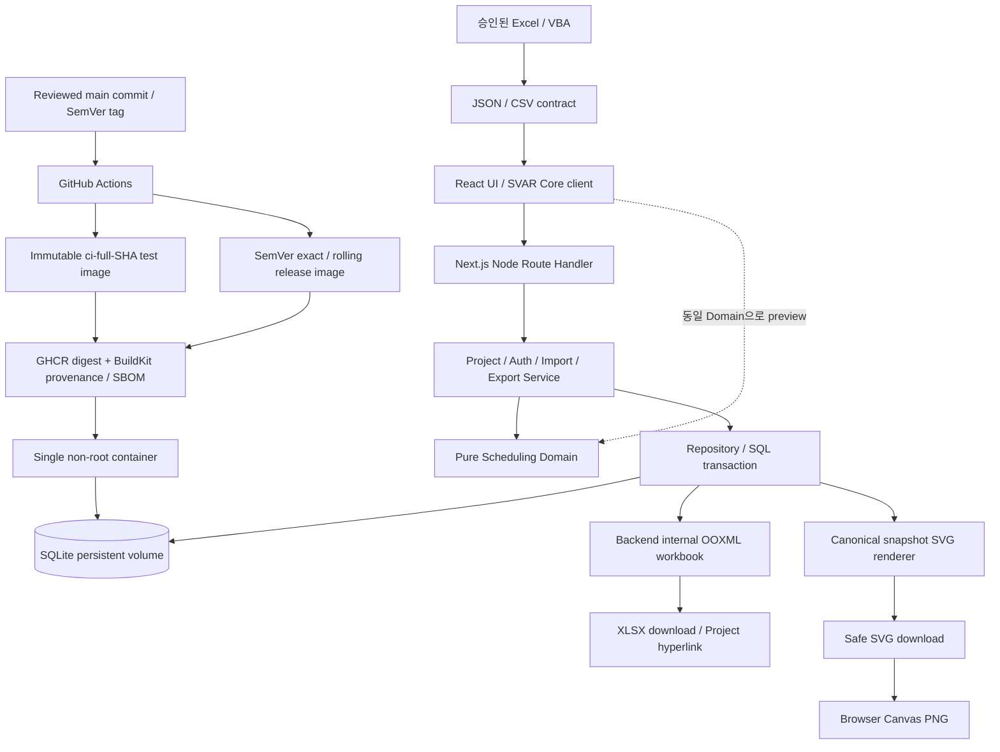

# Architecture draft

## Issue #551 — 실제 native 날짜축 원점과 앱 Timeline lane (2026-10-12)

설치 SVAR Core2.7.3/store2.7.2의 계산 날짜 `contentX`와 화면의 native Chart 물리 scroll은 viewport 제어 과정에서 일시적으로 차이가 발생할 수 있다. `readMilestonePlotGeometry`는 이미 사용하는 실제 Chart plot bbox와 동일 native `.wx-scale` bbox의 상대 원점 `axisOrigin`을 함께 측정하고 앱 소유 sibling lane은 `axisOrigin + contentX`로 마커를 렌더링한다. private Core store write·Chart 자동 선택·새 인스턴스/별도 scrollbar는 추가하지 않는다. Native Chart `scroll`/resize와 기존 queue-version bounded 구독을 유지하며 mount teardown에서 제거한다. 이 계약은 날짜 헤더/Task bar/marker의 실제 DOM X 동등성으로 검증해야 하고, Node-only 계산의 PASS로 대체하지 않는다.

## Issue #637 — canonical projection과 pane overflow 경계

원본 Release #165.1의 실제 DOM trace에서 header add locator의 자동 `scrollIntoView` 구간(44852.545~44853.646ms)에 Grid pane scrollTop이0→28이 됐다. 실제 click(44863.804ms)·add/canonical 적용 이전의 변화이며 Core/Gantt/Chart top은0이었다. Grid 행 y400/h38와 Chart bar y431/h31의 중심 차이27.5px는 이 독립 pane 이동으로 설명된다. 행/바38px 간격·bar top3px/높이31px·scale72px는 유지되어 payload/ID/queue 완료와 정렬 완료가 구별된다.

관찰자는 같은 viewport의 Grid 행과 바깥 `.wx-bar` rect를 비교한다. CSS transform된 내부 Milestone content, Core `$y`, 문서 좌표를 혼합하지 않는다. 원본 TIMED_OUT은 올바른 실패이며 observer1500ms·E2E expect.poll5s·±1px 조건을 유지한다. 수정은 비소유 Grid 세로 overflow 발생 경계에 한정하고 public Core/Gantt의 기존 viewport ownership·가로 Grid scroll·canonical queue·filter/columns/selection 계약을 보존한다. 새 복원 명령·private Core write·retry/remount를 도입하지 않는다.

설치 Grid는 viewport632px에서 내부 `.wx-table`에 `min-height:784px`를 설정해4행(38×4)의 overscan 높이가 X-scroll container의 비소유 Y scrollrange로 노출된다. 앱의 `.project-gantt-widget .wx-table-container > .wx-table`만 `min-height:100% !important; max-height:100%; overflow:clip`으로 실제 viewport에 제한한다. 내부 overscan 데이터·렌더링은 Core에 남기고 table 밖으로 넘친 부분만 clip한다. X-scroll container의 `overflow-x:auto`는 유지한다. [CSS Overflow3](https://www.w3.org/TR/css-overflow-3/#overflow-properties)의 축 계산대로 X auto와 Y clip을 같은 요소에 설정하면 computed Y가 hidden으로 바뀌므로 container 자체 Y clip은 해결책이 아니다. CSS의 기존 Core inline min-height를 이 경계에서만 재정의하며 스크롤 state/좌표를 쓰지 않는다.

설치 Core2.7.3의 `cellHeight`/`scaleHeight`, `resize-chart`/`filter-tasks`는 각각 공식 크기·표시 API이며 DOM 정렬 완료 보증은 아니다. [cellHeight](https://docs.svar.dev/react/gantt/api/properties/cellheight/), [scaleHeight](https://docs.svar.dev/react/gantt/api/properties/scaleheight/), [resize-chart](https://docs.svar.dev/react/gantt/api/actions/resize-chart/), [filter-tasks](https://docs.svar.dev/react/gantt/api/actions/filter-tasks/)를2026-10-12 설치 타입과 대조했다. 실제 demo 조작과 별개다. [#637 근거·AC](exec-plans/active/ISSUE_637.md) 참조.

## Issue #572 — Inline 이름 요청·확정·표시의 분리

native Table `close-editor → update-cell`을 앱의 단일 name-only mutation gateway로 연결한다. 순수 `inline-name-session.ts`는 편집 session·request identity, base revision·원문 draft, Committing/AwaitingConfirmation/Confirmed/Rejected 전이를 소유한다. `saved`는 서버 저장 결과이며 렌더 완료가 아니다. 부모는 검증·적용한 동일 응답 snapshot에서 taskId/revision/name을 반환하고 inline 요청의 전역 성공 toast를 지연한다. 다른 Task Editor·날짜/Chart 명령의 기존 피드백 계약은 유지한다.

Gantt 연결부는 같은 API/session/request의 정확한 confirmation과 현재 canonical DTO, Core `getTask().text`, 실제 mounted Grid 이름 및 관측 가능한 Chart 이름의 정합을 확인한다. 명령 반환이나 projection receipt만으로 이름 렌더 PASS를 만들지 않는다. 정상 자기 PATCH의 revision이 Promise callback보다 먼저 React에 도착해도 요청 identity를 유지하며, 외부 최신 revision·새 세션·API 교체의 늦은 결과는 현재 draft/focus를 덮지 않는다. 원본 native `update-cell`은 계속 차단하고 서버 확정 payload만 기존 #570 projection 경로로 적용한다. 임의 DOM 텍스트 수정·private store write·새 scroll writer는 추가하지 않는다.

실패 draft는 메모리에만 보존하고 같은 작업의 명시 재편집에 연결한다. 자동 재전송·stale base의 묵시적 revision 승격은 금지한다. 이름 변경은 기존 metadata-only 경로이므로 일정/Link/Resource 원장과 #571 viewport 소유권을 바꾸지 않는다. #552 미통합 표시 stack의 활성화는 범위 밖이며 projection에서 제외된 Milestone을 재삽입하지 않는다. [정확한 적용 범위·검증 원장](exec-plans/active/ISSUE_572.md)을 따른다.

## Issue #571 — Viewport Coordinator와 명령 소유권

### Main CI #2504.1: FILTER_RETURN의 완료 후 보호 권한 분리

2026-10-11 Main CI의 실제 #463 Playwright Trace는 FILTER_RETURN(120,0)의 APPLYING/SETTLING 도중 새 Core/native 이동(180,128)이 허용되지 않고 기존 좌표120으로 되돌아가며 TIMED_OUT으로 끝난 것을 보여준다. 수평 DOM capacity는 2563px로 180px을 허용하므로 capacity 문제가 아니라 필터 bookmark의 과도한 scroll-chart intercept/reconciliation 문제다. FILTER_RETURN은 현재 쿼리에서만 1회 복원하고, 이후 다른 정합 Core/native 위치가 보이면 SUPERSEDED로 끝내며 native repair/장기 guard를 획득하지 않는다. PEER_RETURN/PASSIVE_RESTORE의 최신 권한 검증 및 늦은 0px rewind 보호는 유지한다. 원본 실패 [#2504.1](https://github.com/planner77/masterGantt/actions/runs/38139399072)를 보존한다.

2026-10-11 PR #610 보완: #570 canonical projection receipt는 데이터·행·수직 정합까지만 증명한다. 가로 Core/native 불일치는 #571 단일 프로그램 writer/실측 settle의 소유이며, 가로 불일치를 projection success 조건에 넣으면 peer 복구 스크롤 발행 자체가 차단되는 교착을 만든다. 브라우저 viewport/Fullscreen은 restore intent context lease에 포함된다. 확장 준비는 물리 capacity가 충분할 때 no-op, dev-only 날짜 probe/수평 probe는 production adapter의 별도 unsupported ingress다.

#570 projection receipt의 후속 소비자는 단일 Viewport Coordinator다. canonical 데이터·조회 projection의 authority는 그대로 유지하고, viewport 의도/실행/완료 관측만 분리한다. 부모 Workspace는 유효한 visible capture와 typed peer/Task reveal 요청을 전달하며 Gantt native DOM 복원을 별도 실행하지 않는다.

순수 Coordinator는 API/context·intent/projection/geometry·user gesture 세대와 pending operation을 검사한다. 실제 사용자 입력 및 명시 reveal > scope/filter > peer return > passive preservation 순으로 처리하며 늦게 도착한 passive 이벤트가 최근 사용자 의도를 덮지 않는다. production port가 앱 scroll-chart/native 보정과 기존 range compatibility 명령의 실행 경계다. Native Core wheel/Grid reveal은 Core 소유로 유지하고 관측 이벤트를 새 앱 명령으로 재귀 처리하지 않는다. 단일 writer 근거는 production 앱 경로에 한정한다. 기존 #549 개발 전용 __masterganttMilestoneTimeline.reveal→revealMilestoneDate와 #569 PoC/trace fixture의 직접 명령은 진단 예외이며 제품 DATE_REVEAL 지원·단일 writer 실증에 포함하지 않는다.

native Core의 명시 select-task show 이동은 기존 관측 경계에서 Coordinator user-input 세대를 갱신하고 오래된 metadata capture를 폐기한다. 포인터 capture와 실제 Core reveal 사이에 등록된 passive 작업도 취소해야 한다. show:false·canonical-sync·project-owned-selection은 제외하며 새 앱 reveal 명령을 중복 발행하지 않는다.

projection receipt는 행 정합을 보장할 뿐 viewport 완료가 아니다. 동일 canonical revision의 대기 중 관측 generation 변경은 최신 receipt를 따라 geometry 안정 관측을 재시작하며, 적용 직전 고정한 generation이 명령 후 바뀌면 추가 쓰기를 중단한다. metadata/peer 요청은 canonical queue에서 등록한 뒤 queue 밖에서 최신 receipt와 visible geometry를 기다려야 한다. receipt를 생성하는 queue 안에서 viewport 완료를 기다려 교착시키지 않는다. Core exact/native ±1px의 연속 안정 frame과 유한 예산으로 완료·SUPERSEDED·NOT_MEASURABLE·NO_SCROLL_CAPACITY·TIMED_OUT·FAILED를 구분한다.

필터 bookmark는 source context·gesture와 수평 left만 저장한다. FILTER_RETURN은 준비와 실제 적용 각각에서 현재 Core top을 사용하고, 최신 receipt와 함께 Core/native 세로 정합·top 안정성을 확인한다. 조회 결과 감소에 따른 native 세로 clamp를 과거 bookmark top으로 되돌리지 않는다. 대기 중 새 입력·조회 문맥 변경의 취소 계약은 유지한다.

기존 range compatibility 준비는 좌표 적용 전에 PREPARING_GEOMETRY에서 수행한다. 실제 resize를 발행한 경우 준비 전 generation보다 새로운 성공 projection을 요구하고 최신 geometry를 다시 검증한 뒤 좌표 명령의 generation을 고정한다. 준비 중 같은 canonical 데이터의 관측 갱신은 허용하지만 실제 revision·입력·API/조회 문맥 변경은 취소한다. 좌표 명령 이후의 stale generation/receipt 차단은 유지한다.

탭 복귀 직후 논리적으로 visible이지만 chart 크기가 일시적으로0이면 원래 intent 권한으로 중앙 상태 머신에서 유한 대기한다. 측정 전에는 명령을 발행하지 않으며 새 입력·조회 문맥 변경은 대기를 취소한다. port는 detached, hidden/inert, document hidden 및 자체 display/visibility 비활성을 별도로 visible=false로 전달하므로 일시적 크기0과 구분한다. 지속되는 크기0은 실패로 끝내며 새 snapshot으로 재승인하지 않는다.

#569 실험 adapter 제품 채택과 새 날짜 좌표 수식은 DEFER다. 기존 #367 range compatibility를 단일 port로 옮기는 것은 공식 무한 capacity 지원의 실증이 아니다. native-add continuity는 클릭 때의 입력 권한과 API/scope/filter/scale/columns/visible 문맥을 캡처한다. 정상 add의 canonical geometry 갱신을 인계하더라도 실제 사용자 입력·filter·명시 reveal·API 교체는 이전 capture를 취소하며 대기 뒤 fresh 입력 권한으로 재승인하지 않는다. window 복원과 focus도 같은 stale/측정 검사를 따른다. metadata revision만으로 reset/remount하지 않으며 hidden/inert/zero-size capture, stale async write, 무한 RAF를 금지한다. [구현·검증 Work Packet](exec-plans/active/ISSUE_571.md)을 따른다.

## Issue #570 — Canonical projection과 native 동기화 경계

서버 ProjectSnapshot/revision은 계속 유일한 저장 authority다. Gantt projection은 canonical Task/Link 전체 입력, scope/filter/display mode의 membership, 접힘 상태의 논리 visible order, 가상화된 DOM subset을 구분한다. DOM에 없는 접힌 자식이나 offscreen 행은 데이터 삭제를 뜻하지 않으며, 허용 ID의 부분집합 검사만으로 필수 행 정합성을 승인하지 않는다.

순수 `buildProjection`/`diffProjection`은 data·structure·membership·layout 변경 이유를 분리한다. 같은 membership의 metadata-only 갱신은 canonical Task payload만 동기화하고 filter/columns를 다시 설정하지 않는다. 실제 구조·조회 집합 변화 또는 Core 설정 전환으로 투영이 초기화된 경우에는 필요한 공개 action을 재검증한다. 열 getter는 최신 canonical DTO를 참조하며 사용자 width/flexgrow와 기존 Summary 접힘·selection을 보존한다.

새 canonical 작업은 존재하는 형제를 기준으로 공개 before/after 삽입해 형제 순서를 유지한다. 삭제될 부모 아래에서 canonical에 살아남는 자식은 Core subtree 삭제 전에 안전하게 분리한 뒤 최종 계층에 배치한다. 서버 subtree 삭제와 여러 revision을 건너뛴 표시 동기화를 혼동하지 않으며 표시 보정을 서버 mutation으로 다시 저장하지 않는다. 기존 자식이 있는 접힌 Summary로 passive 이동할 때 Core의 자동 열림은 공개 open-task로 원래 접힘을 복원하고 사용자 의도를 덮어쓰지 않는다. 첫 자식이 생기는 신규 container의 기존 auto-open 계약은 유지한다.

현재 revision·API instance·generation이 유효한 작업만 직렬 queue에서 적용한다. projection 완료는 명령 반환과 구분하며 실제 Core payload/논리 행 순서와 native DOM subset·텍스트·행 정렬을 유한 관찰한 receipt로 전달한다. 이 receipt는 #571의 입력이며 viewport를 직접 쓰거나 새 data authority를 만들지 않는다. #569 adapter 제품 도입 DEFER와 #552 미도입 표시 전환 경계는 유지한다. 상세 구현·검증 범위는 [Work Packet](exec-plans/active/ISSUE_570.md)을 따른다.

### #571에 전달하는 projection receipt

Gantt frame은 `mastergantt:projection-settled` DOM event의 detail로 `revision`, `apiInstance`, `generation`, `reasons`, `outcome`, 논리/Core/DOM ID 관측, columns/scale, scope/filter identity, `queryConditionsChanged`, `taskSelectionChanged` 및 selected IDs를 전달한다. 필터 원문이나 Task 내용은 event payload에 포함하지 않는다. `outcome=SETTLED`만 실제 관측 성공이며 `SUPERSEDED`, `NOT_MEASURABLE`, `TIMED_OUT`은 성공과 구분한다. 소비자는 최신 revision·instance·generation과 자신의 intent를 다시 확인해야 하며 이벤트 이름 자체를 성공으로 취급하지 않는다. 개발 전용 `data-gantt-projection-receipt`는 동일 결과의 검사 창구다.

SETTLED의 범위는 canonical Task/Link payload, 행 membership·순서, Grid/Chart 텍스트 및 수직 행 정합이다. bar의 수평 X/width, native Link DOM 기하, 최종 viewport/date reveal 완료는 이 receipt로 보장하지 않는다. #571 소비자는 #569의 기하 검증을 별도로 통과해야 한다.

관찰은 유한 timeout과 RAF/timer cleanup을 가지며 조회 조건 변화와 실제 선택 action을 구분한다. `queryConditionsChanged`는 각 관찰을 시작할 때 직전 전달한 receipt의 조회 identity와 비교한다. 최초 effect 설치 시의 값을 선택·접힘·layout 재관찰에 재사용하지 않는다. `taskSelectionChanged`는 native 선택 action과 같은 API instance에서 마지막 전달 receipt 대비 실제 selected IDs의 차이를 확인한다. 선택 직후 effect 재설치나 layout 관찰이 앞선 관찰을 대체해도 아직 전달하지 않은 선택 변화는 다음 유효 receipt에 남는다. 이 이벤트를 받았다는 이유만으로 #571의 scroll intent 우선순위/단일 writer 구현이 완료됐다고 보고하지 않는다.

필터 뒤 Summary 열림/접힘 복원은 현재 Core Task에 실제 자식이 있는 container에만 적용한다. 빈 Summary 및 마지막 자식이 삭제된 Summary에 `open-task(true)`를 보내면 Core 2.7.3의 null 자식 컬렉션 순회 오류로 복구 경로가 실행될 수 있다. 저장된 사용자 intent는 유지하되 자식 없는 행을 여는 명령으로 바꾸지 않는다.

무필터 상태의 fast path도 마지막으로 적용한 structure key가 같아야 한다. `serialize()`의 canonical Task가 갱신되어도 Core `_tasks`에 이전 Summary 렌더 payload가 남을 수 있으므로 행 ID 일치만으로 구조 변경의 재투영을 생략하지 않는다. metadata-only의 같은 구조·membership에서는 기존 action 0회 계약을 유지한다.

metadata viewport 복원 직후에도 Core의 늦은 native scroll event가 원래 가로 위치를 덮을 수 있다. 기존 Editor·no-op canonical sync의 일회성 snapshot/복원은 유지한다. 잔존 guard는 직전 완료한 baseline 대비 실제 Task metadata 또는 Project revision 변경이 있고, 같은 geometry·semantic filter·API/DOM·scale·열폭·사용자 입력 없음이 확인된 복원에 한정하여 기존 peer scroll guard를 재사용한다. metadata guard에는 완료한 geometry와 revision을 추가하고 다음 revision·geometry·조회 문맥 변경 시 layout effect에서 해제한다. 기존 peer authority를 덮지 않으며 동일 guard의 사용자 입력 취소와 native repair 최대 3회 예산을 유지한다. 새 viewport writer나 #571 Coordinator를 도입하는 변경은 아니다.

기존 metadata request의 복원 시도는 한 번만 소비하고, 유효한 capture는 다음 같은 문맥의 canonical metadata/revision 변경에 인계할 좌표로 보존한다. RAF 대기 중 supersede되어 명령을 실행하지 못한 경우에도 입력·geometry·API/DOM·peer 문맥이 같으면 좌표 인계는 유지하되 오래된 명령을 다시 실행하지 않는다. 중간 no-op 복원은 현재 좌표를 사용하고 이 인계 좌표를 transient native reset으로 교체하지 않는다. baseline의 metadata/revision은 최신 복원 시도가 끝난 뒤 갱신한다. Chart/Grid pointer·wheel·keyboard·touch, 명시 검색/필터 입력, geometry·scope/숨김, API 교체, peer 복원 및 unmount는 capture를 폐기하고 listener를 정리한다.

빈 projection에는 보존할 행 viewport가 없으므로 metadata snapshot을 만들지 않는다. 실제 ID 집합이 빈집합으로 바뀐 뒤 후속 no-op sync가 native clamp 중의 임시 비영점 좌표를 다시 보존하는 것을 방지하며, 별도 scroll writer 없이 기존 Core의 빈 결과 처리를 따른다.

## Issue #569 — 공개 API Adapter의 도입 전 경계

[Adapter ADR](GANTT_ADAPTER_ADR.md)은 Core/native 읽기와 공개 scroll/date reveal/finite settle 명령을 분리하는 인터페이스·PoC다. 제품 ProjectGantt의 기존 viewport writer나 Coordinator를 교체하지 않는다. 공개 controlled scale 설정과 native chart를 같은 좌표계로 검증하고 hidden/inert/zero-size를 유효한 viewport로 저장하지 않는다.

A(autoScale)/B(명시 범위)/C(2.7.3 resize 호환)의 실제 성공·실패와 보존 조건을 비교한 뒤 후속 도입 여부를 판단한다. C의 synthetic width는 공식 physical container 의미 밖의 예외이므로 버전 가드·명시 opt-in·유한 상한을 갖는 교체 가능한 모듈로 한정한다. 직접 Store/DOM 폭 쓰기·PRO·서버 상태 authority 추가는 없다.

## Issue #568 — 동기화 관측 도구의 경계

비교 stack의 filter 이후 native clamp→Core scroll 반영은 관측 순서이며 직접 DOM writer는 미확정이다. 이 결과만으로 Core 결함이나 adapter 수정 방향을 확정하지 않는다.

[Core Action Trace](GANTT_SYNC_TRACE.md)는 #567의 설계 가설을 실측하기 위한 dev/test-only 도구다. 서버 canonical snapshot/revision, React projection, Core 공개 state, native DOM geometry, 사용자 intent를 서로 다른 관측 층으로 기록한다. trace가 제품 상태 authority나 두 번째 viewport writer가 되어서는 안 된다. Core 단독/React wrapper와 고정 PR #562 앱의 관측을 같은 source라고 취급하지 않는다.

명령 반환·Core state 변경·native layout 안정화를 별도 분류한다. 공개 getState 좌표와 native scroll capacity·3개 연속 안정 frame을 bounded timeout 안에서 확인하고 superseding intent를 실패·성공과 구분한다. 최신 공식 exec 문서의 void 선언과 설치 2.7.3 타입/실행 반환은 별도 검증 대상이다. 실제 첫 writer가 관측되지 않은 원인은 가설로 남긴다. 단일 Coordinator 및 geometry adapter의 제품 도입은 후속 이슈에서 결정한다.

## Issue #538 — Project master relations

계층 관계는 SVAR와 분리된 전역 Project Master Domain이다. `project_master_items`는 안정된 item authority, `business_unit_products` 및 `business_unit_product_sites`는 재사용 가능한 연결 authority, Project는 기존 nullable FK를 보유한다. `Route Handler → ProjectMasterService → ProjectMasterRepository → SQLite`의 transaction boundary에서 관계 생성/해제·Project 조합 validation·catalog revision 경쟁 검사를 실행한다. Frontend cascading은 서버의 `relations`를 읽는 projection이며 자체 Source of Truth가 아니다.

## Issue #459 — Stage Gate 통합 데이터 흐름

Stage Gate는 별도 Gantt 엔진이나 UI별 계산기가 아니라 하나의 canonical Project snapshot에서 파생되는 공통 도메인 projection이다.

```text
SQLite explicit membership + canonical Task/Link/WBS
  → projectStageGates / milestone-stage-core
  → canonical Project Task.membership + Milestone.stageGate
  → Task Editor / Gantt Grid·filter / Milestone Dashboard
  → Logistics·Resource drill-down / JSON·Excel projection
```

- 저장 authority는 explicit Task/Summary→Milestone row이며 effective membership과 Ready는 full hierarchy/Link snapshot에서 계산한다.
- Task→Task 실행 Dependency와 Milestone→Milestone Gate Dependency는 같은 Link 저장소를 사용하더라도 의미를 섞지 않는다. member Task들의 Dependency를 단계 edge로 자동 투영하지 않는다.
- UI scope/filter/접힘/현재 Dashboard 조건은 Stage 계산 authority가 아니다. 화면은 서버 canonical projection 또는 동일 pure domain preview를 소비한다.
- Dashboard와 Export는 Ready/진척을 독자 계산하지 않고 같은 typed projection을 사용한다. 부분 물류·Resource 조건은 단계 선택/공수 범위를 제한할 수 있지만 full-stage Ready를 재정의하지 않는다.
- Import/Copy/Template는 explicit row identity를 remap·보존하고 파생 projection을 입력 authority로 저장하지 않는다.

#460~#464가 이 경계를 각각 저장/Editor/Gantt/KPI/교환 경로에 구현한다. 세부 계약은 [Milestone Stage Gates](MILESTONE_STAGE_GATES.md)를 따른다.

## Issue #460 — 공유 Stage Gate 경계

`src/domain/milestones/stage-gates.ts`는 SVAR/SQLite와 독립된 전체 hierarchy 상속·Ready·완료 진단·구조 잠금 계산이다. 브라우저 DTO adapter/draft preview도 같은 pure 함수를 사용한다. `MilestoneMembershipRepository`는 explicit row만 저장하고 `milestone-stage-core.ts`가 DB snapshot/projector/보존 guard를 공유한다. Route → Service → Repository → SQLite 경계와 IMMEDIATE transaction/session/revision을 유지한다. 각 Task/Link/hierarchy/subtree/metadata canonical 응답에 같은 projection을 반영하며 Calendar/Assignment/Logistics 전용 응답은 기존 갱신 계약을 유지한다. 신규 UI나 별도 Gantt 엔진은 도입하지 않는다. [상세 저장·경로 inventory](MILESTONE_STAGE_GATES.md)를 따른다.


## Issue #464 — 보존과 JSON 교환 서비스

`ProjectImportService`는 기존 Repository/Task DTO/Calendar/Scheduling/Stage guard를 조합하여 create-only preview/commit을 제공한다. HTTP handler가 Origin/session/strong revision과 bounded file parser를 연결하고 wrapper는 기존 DB/Project authorization을 재사용한다. Parser는 fatal UTF-8/한 BOM/duplicate key/JSON syntax depth64를 JSON.parse 이전에 확인한다. `validateProjectImportPayload`는1.0 pure validator를 그대로 dispatch하고1.1 authored leaf/Summary/membership을 검증한다. source UUID/Calendar는 참고이며 target Calendar와 새 UUID가 authority다. preview read transaction과 commit IMMEDIATE transaction에서 권한/revision/collision/budget/전체 E/P 완료 guard를 재검증한다. digest는 상태 없는 file+target+baseRevision binding이며 preview 저장소나 새로운 권한 모델은 없다. canonical201 응답은 기존 ProjectSnapshotResponse/permission edit를 사용한다.

`ProjectJsonExportService`는 같은 DB read transaction과 clock1회에서 전체 canonical snapshot을1.1 authored 파일로 변환한다. 기존 mixed Dependency도 원형 유지하고 imports는 신규 mixed 정책으로 전체 거부한다. JSON은 source UUID/metadata만 전달하고 Resource/물류/Password/session·새 Direct Hyperlink를 추가하지 않는다. `ProjectExportSnapshotService`는 Excel 전용 canonical/defaultStage/optionalResource bundle을 같은 read transaction에서 만들고 Project/Catalog revision을 확인한다. Stage 산식/Ready를 workbook에서 재계산하지 않으며 default 전체F는 현재 Dashboard 필터와 별개다. writer는 원시/null 수치와 행별 식별자를 OOXML inlineStr/안전 숫자로 출력하고 한도 초과는 전체 실패다.

Copy/Template은 explicit FK remap과 서버 소유 전체 보존 검증을 사용한다. subtree Copy의 사용자 확인은 외부 소속·상속·destination 효과만 확인하며 Assignment/완료/권한 잠금을 우회하지 않는다. trusted historical completion baseline은 완전 보존된 서버 Copy에만 허용하고 외부 JSON import는 사용하지 않는다. 저장 schema/migration/Calendar·Dependency 알고리즘/Resource engine은 변경하지 않는다.


상태: Manager 통합 설계. W01–W07의 Project·authorization, pure Calendar/Leaf Scheduling과 root Task/Milestone persistence, W20의 CI/CD·최소 container artifact 기반 및 W21의 동기 Grid+Chart 작업공간을 구현했다. W24는 child 저장·Summary 집계와 순수 WBS 계산을 선행했고 Excel 및 Issue #245 SVG/PNG 내보내기를 추가했다. 이 상태가 Import 전체, W08 전체 또는 production 배포 승인을 뜻하지는 않는다. 요구사항은 [REQUIREMENTS.md](REQUIREMENTS.md), 설계 판단은 [DECISIONS.md](DECISIONS.md)에서 관리한다.

## 경계



위 Repository→Export 화살표는 snapshot DTO 전달이다. Export Service가 조회를 조정하며 Repository가 OOXML/SVG writer를 import하지 않는다. 모든 persistence 접근은 Service 아래 Repository를 통한다.

| 영역 | 책임 | 금지하는 결합 | 최초 담당 |
| --- | --- | --- | --- |
| Frontend | Project UI, browser-only SVAR, unlock, preview, validation·loading·error, server 결과 반영 | DB/native module/secret import, UI 상태로 권한 판정 | frontend |
| Route | HTTP parse·size/content-type 제한·응답 | SQL과 scheduling 알고리즘 | backend |
| Service | Project authorization, validation, revision, transaction 조정, Domain 호출 | SVAR store를 진실의 원천으로 사용 | backend |
| Repository | bound SQL, scope, FK·snapshot·atomic persistence | business scheduling, workbook 생성 | backend |
| Domain | date/calendar, graph, summary/WBS, deterministic calculation | React, SVAR, DB, network, 현재 시각의 암묵 의존 | scheduler |
| Excel/VBA | Header mapping, 필요한 셀 정규화, JSON/CSV·오류 보고 | DRM 우회, backend schema 단독 변경 | excel_vba |
| Export | DB snapshot→XLSX 또는 결정적 SVG; 브라우저에서 SVG→PNG | PRO export, token hyperlink, 외부 변환 서비스 | backend + frontend |
| Deployment / CI | Node/native build, Actions, Semantic release, GHCR, volume·permission·health·backup | image 안의 DB/secret, PR write token, mutable image를 test 기준으로 사용, 다중 writer instance | infra |
| QA | 실제 계약과 결과의 독립 비교 | 구현 Agent 보고를 그대로 PASS 처리 | qa_docs |

## 제안 Directory 구조

아래는 목표 구조다. W01–W07에서 `app`, `components`, `features/gantt`, `features/projects`, `contracts`, `domain/scheduling`, `server/db`, `server/repositories`, `server/projects`, `server/security`, `db/migrations`, 관련 `tests` 경로를 만들었고 나머지는 담당 작업에서 추가한다.

```text
src/app/                         Next.js pages and HTTP routes
src/components/                  general UI
src/features/gantt/              SVAR client wrapper and adapters
src/features/import/             wizard, mapping, preview
src/server/projects/             implemented Project contract/service/HTTP orchestration
src/server/security/             credential/session/cookie/origin/rate primitives and route policy inventory
src/server/services/             future cross-feature service orchestration
src/server/repositories/         SQL access
src/server/db/                   connection and migration runner
src/domain/scheduling/           pure domain and fixtures
src/contracts/                   validated API/import DTOs, no server imports
db/migrations/                  ordered SQL, no actual database
excel/vba/                      future approved VBA POC and exporter
tests/                          integration / browser / deployment evidence
.github/workflows/              PR/main CI and SemVer-tagged GHCR release
scripts/                        migration, version validation, container smoke helpers
docs/                           sources of truth and execution plan
```

`server-only` 경계와 dependency rules로 DB·crypto/session 모듈이 client bundle에 유입되지 않게 한다. Native driver를 쓰는 route는 Node runtime이다. Edge runtime과 serverless ephemeral filesystem은 초기 배포 대상이 아니다.

## Frontend와 SVAR

현재 UX 우선 계약은 [PROJECT_UX.md](PROJECT_UX.md)다. PR #23에서 첫 child 전환 팝업을 생략하고 설정을 헤더 버튼의 별도 모달로 변경했다. 서버의 `convertParentToSummary: true`, session/Origin/If-Match 및 독립 집계 계약은 유지한다.

SVAR 공식 Next.js guide의 client wrapper, theme/CSS, `init` API를 따랐고 W03에서 browser-only mount와 production build를 검증했다. [공식 integration guide](https://docs.svar.dev/react/gantt/integration-guides/nextjs/setup/), [W03 검증](W03_REVIEW.md)

Project Direct GET snapshot은 Cookie가 있어도 항상 Readonly다. UI는 별도 current-session GET으로 edit 표시를 동기화하고 password unlock 뒤 metadata/password/logout control을 활성화한다. 서버는 UI 상태와 무관하게 매 mutation에서 Project-bound session을 다시 확인한다.

UI는 공식 task/link/hierarchy editor를 우선 사용한다. Adapter가 external ID↔SVAR ID, date-only↔Date, end 포함↔SVAR endpoint 의미, working-day duration↔calendar span, domain link type↔SVAR link type을 변환한다. W07은 설치된 Core 2.7.3에서 실제 이동·좌우 resize를 수행해 exclusive widget end↔inclusive domain end 변환과 서버 저장 왕복을 확인했다. 최종 콜백의 전체 Task 상태는 기존 endpoint와 비교해 move/start-resize/end-resize 명령으로 구분한다.

편집 명령은 Core `onUpdateTask`의 최종 이벤트만 API로 보낸다. 요청 동안 동일 aggregate 후속 변경을 동기 mutex로 막고, 성공 시 전체 canonical snapshot으로 교체한다. 실패·412·응답 불확실성에는 `no-store`로 서버를 재조회하며 Project identity와 revision을 검증한다. 재조회 실패나 오래된 응답은 마지막 서버 확정 snapshot을 동일 SVAR 인스턴스의 공개 serialize/exec 동기화 경로로 다시 적용한다(#344). 요청의 실패로 이전 성공 변경을 되돌리거나 widget을 재마운트하지 않는다. 공개 SVAR 동기화 자체가 예외를 낸 경우의 최후 reset fallback은 별도 경로로 유지한다. PRO auto-scheduler를 실행하지 않는다. 공식 Data Provider는 본 프로젝트의 cookie/If-Match/canonical full snapshot 계약과 맞지 않아 W07에서 직접 채택하지 않았다.

Issue #3에서는 React canonical snapshot 교체와 SVAR 재마운트를 분리한다. 정상 저장은 동일 인스턴스에서 공개 serialize/exec 기반 차이 반영을 사용하며 요청 중 잠금은 권한/readonly와 분리한다. 기존 scroll·선택·접힘을 우선 보존하고 임의 신규 행 이동을 하지 않는다. 내부 반영은 사용자 command로 재전송하지 않는다. 상세 정책과 실제 검증 상태는 [Issue #3 기록](ISSUE_3_REVIEW.md)을 따른다. 현재 Grid Header `+`와 행 `+`는 입력창 없이 `새 작업`, 브라우저 local 오늘, 기간 1일을 적용한다. 첫 child의 일반 Task→Summary 전환도 별도 확인창 없이 아래의 명시적 서버 옵션으로 원자 처리한다.

Project route는 Demo navigation 없이 하나의 SVAR Gantt 인스턴스를 `displayMode="all"`로 실행한다. 같은 Task tree를 Grid와 Chart가 공유하며 Core의 세로 동기화와 Resizer를 사용한다. W24는 native `add-task` column을 표시하되 `api.intercept`로 로컬 임의 생성을 차단한다. 전체 Project의 Header `+`는 root를, 행 `+`는 child를 즉시 요청한다. #418의 scoped Workspace에서는 같은 Header `+`를 active Summary root의 immediate child로 정규화하고 Row `+`는 해당 row child로 정규화한다. UI enabled/disabled와 실제 target은 하나의 resolver를 공유하며 edit session·If-Match·서버 계산을 거쳐 canonical snapshot만 반영한다. canonical Core sync와 `filter-tasks`도 같은 직렬 queue에서 처리해 scope frame의 중간 empty 상태를 노출하지 않는다. 첫 child 생성의 일반 Task→Summary는 UI 확인창을 사용하지 않고 `convertParentToSummary: true`를 명시하며, 서버가 parent 전환/child 생성/ancestor 저장/revision 증가를 한 transaction에서 검증·처리한다. Milestone parent와 유효하지 않은 전환은 계속 거부한다. Summary min/max·근무일 span·하위 Leaf 가중진척은 독립 `recalculateHierarchy`에서 계산한다. Summary의 계산 일정은 직접 편집하지 않으며 기존 이름/설명/URL 필드 정책을 따른다. 자식 없는 Summary 자체는 단건 삭제할 수 있고 자손이 있으면 명시적 subtree 삭제를 사용한다. WBS는 이 순수 계산 결과에 포함되지만 아직 HTTP DTO나 Grid에 노출하지 않는다. Reparent와 FS 계산·저장은 별도 범위다.

Project 작업공간은 viewport 기반 flex/min-height 경계 안에서 Project header와 설정 control을 유지하고 SVAR 내부를 세로 스크롤한다. Grid/Chart header는 Core sticky 동작을 사용한다. Project 정보·비밀번호 변경·편집 종료 설정은 header의 `프로젝트 설정` 버튼으로 여는 별도 modal에 두며, 프로젝트명 아래의 과거 기본 접힘 패널은 표시하지 않는다. 설정 modal을 열고 닫아도 Gantt를 재마운트하지 않는다. 좁은 화면에서도 Grid와 Chart를 함께 유지하는 내부 가로 scroll을 제공하고, 외부 ID 표시 상태는 revision remount 밖에 보관한다. Chart 주말은 `highlightTime`을 사용하고 Grid/scale/List 날짜는 사용자 locale로 표시한다. Date-only는 원래 달력 날짜를 유지하며 instant timestamp만 브라우저 시간대로 표시한다.

화면: Project List/Create, Direct Gantt, Edit Unlock, Import Wizard, Export. UI toolkit은 shadcn/ui와 Tailwind 후보이며 설치 시 license·version을 확인한다. 핵심 Gantt 기능은 Core를 사용한다. Project List는 D02 승인에 따라 앱 접속자 전체에게 공개 summary만 제공한다. 빈 목록과 DB 오류는 구분하며 생성 후 복귀 및 reload 시 최신 목록을 조회한다.

Project 경로는 `Route Handler → ProjectService → ProjectRepository/EditSessionRepository/ScheduleRepository → SQLite`를 따른다. Route가 canonical `APP_BASE_URL`과 unsafe method의 exact `Origin`, UTF-8 JSON content type, 32 KiB body, strict Zod input을 검사한다. Service는 비동기 scrypt를 transaction 밖에서 수행한다. Task mutation은 짧은 `BEGIN IMMEDIATE` transaction 안에서 session을 다시 검증하고 revision을 비교한 뒤 Leaf는 W06 `scheduleLeaf`, W24 child/ancestor 변경은 `recalculateHierarchy`를 호출해 저장하며 revision을 정확히 한 번 증가시킨다. Direct read와 mutation success는 canonical DTO를 반환한다. Collection GET은 D02 승인으로 no-store 공개 summary 목록을 반환하며 credential/session을 조회하거나 편집 권한을 부여하지 않는다.

## 쓰기와 동시성

1. Route가 Origin/content type/입력 크기를 검사하고 Project public ID를 해석한다.
2. Service가 해당 Project의 session 유효성을 검증한다.
3. 입력 계약과 현재 aggregate snapshot을 검증하고 scheduling candidate를 계산한다.
4. 짧은 write transaction 안에서 session/revision을 최종 확인하고 필요 시 동일 snapshot을 사용해 계산한다. 계산과 저장 사이 revision이 달라지면 재시도·덮어쓰기 대신 412를 반환한다.
5. Project/tasks/links/summary 결과를 함께 저장하고 revision을 한 번 증가시킨다.
6. canonical snapshot과 ETag를 반환한다. 실패 시 전체 상태는 이전과 같다.

빈 Summary를 직접 생성할 수 있고 자식 생성·재배치 같은 hierarchy 변경은 [API](API.md)의 원자적 mutation 계약으로 제출한다. 숨은 cascade 삭제를 하지 않는다. Schema는 [DB_SCHEMA.md](DB_SCHEMA.md) 참조.

## Scheduling

Input에는 사용자 요청 `requestedStart`와 duration, mode, parent/order, calendar, FS/SS/FF/SF 및 signed lag 관계가 있다. Output에는 effective start/end, summary, WBS, 변경 이유·오류가 있다. W06은 자체 Gregorian ordinal 기반 date-only·Calendar·Leaf/Milestone 계산을 먼저 구현했으며 system timezone과 `Date` instant API에 의존하지 않는다. W24 당시에는 Parent graph를 검증하고 child Leaf에서 Summary와 WBS를 계산했으나 WBS를 저장·전송·표시하지 않았고 Reparent와 FS 계산도 후속 범위였다. 현재 관계 계산은 generic dependency engine을 사용하며, Service가 요청값과 계산값을 분리 저장하므로 dependency 제거·앞당김 시 원래 요청일로 복귀할 수 있다. Server의 계산이 권위이며 browser preview는 같은 pure code를 사용해도 저장 권한은 없다. 상세 규칙은 [SCHEDULING_ENGINE.md](SCHEDULING_ENGINE.md)만이 정의한다.

## Import / Export

Excel→VBA→JSON/CSV는 [VBA_EXPORT.md](VBA_EXPORT.md)의 승인된 환경 POC를 선행한다. [IMPORT_SCHEMA.md](IMPORT_SCHEMA.md)는 producer/consumer 공동 검토 후 Manager가 승인한다. 파일의 Project metadata가 URL의 기존 Project를 바꾸거나 session을 제공할 수 없다.

서버 preview는 정규화와 모든 graph/calendar validation을 수행한다. Commit은 원본 정규화 payload를 다시 검증하고 `If-Match`를 확인한 후 원자적으로 저장한다. 초기 create-only batch는 업데이트·삭제·replace를 수행하지 않는다. Fixture 파일을 이용한 웹 parser 개발과 실제 조직 Excel POC의 통과 상태를 구분한다.

Web export는 일정 DTO의 DB 일관된 snapshot을 얻고 transaction 밖에서 내부 OOXML/ZIP writer로 Excel workbook을, 자체 renderer로 안전한 SVG를 생성한다. PNG는 브라우저 Canvas가 같은 SVG를 변환한다. 현재 Excel 계약은 [EXCEL_EXPORT.md](EXCEL_EXPORT.md), 이미지 계약은 [IMAGE_EXPORT.md](IMAGE_EXPORT.md)를 따른다. [IMPORT_EXPORT.md](IMPORT_EXPORT.md)의 초기 단계 계획과 충돌하면 현재 구현 계약이 우선한다.

## Security와 운영

W04 생성 bootstrap에 이어 W05는 recorded scrypt profile의 timing-safe password 검증, unknown/corrupt credential dummy KDF, Project-bound session의 expiry/revoke/auth-version 검증, logout, password rotation과 metadata mutation authorization을 적용한다. Cookie는 8시간 HttpOnly/SameSite=Strict이며 production에서 Secure/`__Host-`를 강제한다. Unlock은 bounded process-local global+Project limiter와 공유 KDF concurrency 2 상한을 사용한다. [SECURITY.md](SECURITY.md)가 세부 정책이다. Public URL은 편집 권한을 부여하지 않지만 읽기 기밀성을 보장하는 인증도 아니다. production 노출 범위는 사용자 결정 항목이다.

초기 운영은 한 Node application container와 local persistent SQLite volume이다. Native addon은 빌드·런타임 ABI/libc/architecture를 일치시키고 non-root permission과 restart persistence를 검사한다. PR과 수동 CI는 read-only로 application/browser/container 회귀만 수행한다. 모든 gate를 통과한 비문서 `main` push는 `ci-<full SHA>` image를 게시해 registry exact digest runtime을 검증한다. version이 유지된 merge는 해당 package version을 정리하지만 version-changing merge의 verified candidate는 formal release까지 보존한다. Release는 `package.json`과 일치하며 이전 tag보다 큰 annotated Semantic Version만 직렬 처리하고, tag target SHA의 Main candidate source/revision/version/digest와 runtime을 재검증한 뒤 **새 build 없이 동일 digest를 exact SemVer와 stable rolling alias로 promotion**한다. Consumer와 post-publish smoke는 mutable alias가 아니라 exact version/digest를 사용한다. WAL-aware backup과 production host restore는 별도 경로에서 시험한다. [CI_CD.md](CI_CD.md), [DEPLOYMENT.md](DEPLOYMENT.md) 참조.

## 구현 진입 Gate

최초 vertical slice인 Project 생성→SQLite 저장→Direct Readonly→unlock→root Task 생성·SVAR 이동/resize→reload 유지→삭제를 W07에서 독립 QA PASS / Manager ACCEPT했다. W20 Semantic Release, W21 동기 Grid+Chart와 W22 main commit image 자동화도 완료했다. Main/PR/release workflow, private GHCR publish, commit/release digest의 원격·로컬 smoke와 SBOM/provenance 조회를 PASS했다. D05에 따라 현재 private 요금제의 ruleset 미강제 위험을 수용하고 GitHub Artifact Attestation은 비활성으로 둔다. W23은 D02 승인으로 목록을 활성화했다. W24가 W08의 child 생성·Summary 집계·순수 WBS 계산 일부를 선행하며, WBS DTO/UI·Reparent·FS와 유효 subtree 변경 묶음은 후속이다. VBA는 D01, 운영 공개는 D03 및 별도 네트워크/TLS 배포 검증을 따른다. 전체 기능을 한 번에 시작하지 않는다.

## Project Workspace UI 계층 (Issue #76)

Frontend shell은 **Global App Shell → Entity Context → Workspace View** 3단 계층을 사용한다.

- `WorkspaceShell`: viewport 기반 global header와 primary navigation을 제공하고 Project 전용 metadata/action을 소유하지 않는다.
- `ProjectReadonlyView`: compact Project context, permission status, Project Info/Settings/Unlock command와 `일정 / 리소스` peer view를 조정한다.
- `ProjectGantt`와 `ProjectResourceWorkload`: 동일 Project context의 독립 workspace panel이다. tab 전환은 API mutation이나 route navigation이 아니며 panel mount를 유지해 Gantt lifecycle/state를 보존한다.
- Resource workload API, edit-session, If-Match/revision, canonical snapshot, Scheduling Domain 경계는 UI 재배치와 독립적으로 유지한다.

Frontend 레이아웃과 interaction 상세 기준은 [UI/UX Guidelines](UI_UX_GUIDELINES.md)를 Source of Truth로 사용한다.


### Link command vertical slice (#97)

SVAR `add-link`/`delete-link` actions are intercepted before local commit. The Project workspace calls protected Link routes; `LinkService` validates the project graph, recalculates schedules and summaries, persists Link/Task/Project revision atomically, and returns the canonical snapshot for in-place Gantt synchronization.


## Issue #84 검색 Filter 경계

Issue #83에서 도입한 Task/Resource view filter와 Project List filter는 UI와 domain predicate를 분리한다. `project-search-filter.ts`의 공통 text normalization/operator primitive를 Task와 Project adapter가 공유하고, Project 전용 날짜/owner 조건은 `project-list-filter.ts`에 둔다. Project List adapter는 `ProjectListItemDto[] + browser timezone + deletedIds + view state`를 입력으로 하는 결정적 read-only 함수이며 API/DB/Project revision에 의존하지 않는다.

처리 순서는 `public summary → deletedIds 제외 → quick search → advanced clauses → visible result`다. client-side list filtering은 서버 authorization 근거가 아니며 Project mutation/security 경계를 변경하지 않는다. Project 수가 실제 client filtering 한계를 넘는 근거가 생기기 전에는 server-side search/pagination을 도입하지 않는다.


### Project status client mutation 경계 (#177)

Project-level status 변경은 새 서버 endpoint나 DB 계층을 만들지 않고 기존 metadata PATCH를 재사용한다. `src/features/projects/project-status-mutation.ts`가 List와 Workspace의 공통 client transport 경계를 담당하여 최신 status/revision 조회, current edit-session 확인, unlock 호출, status-only PATCH 및 canonical metadata mutation 판별을 한 곳에 둔다. 인증 dialog와 UI state ownership은 각 화면에 남겨 List의 password-on-demand 흐름과 Workspace의 기존 edit mode를 억지로 합치지 않는다. 412 복구는 canonical snapshot을 다시 적용하고 Gantt reset generation을 변경하지 않아 Project metadata 변경과 SVAR instance lifecycle을 분리한다.


## Issue #258 — Task 필드 PATCH와 일정 후보 경계

`src/domain/tasks/task-patch-fields.ts`의 pure `classifyTaskPatch`가 Client와 Service의 일정/비일정 필드 분류를 공유한다. 권한과 strict 입력 검증은 기존 Route/Service가 수행하며 분류 결과 자체는 권한이 아니다.

`ProjectService.updateTask`는 현재 aggregate 유효성을 확인한 뒤 field-only 요청에서는 저장된 effective start/end/requestedStart를 쓰고 Summary 진척/Baseline을 파생한다. 일정 요청에서는 직접 Task의 Calendar 계산과 end assertion을 먼저 검증하고 `src/domain/scheduling/task-candidate.ts`의 `recalculateTaskCandidate`에 전체 Project Task/Link를 넘긴다. 후보는 leaf requestedStart 재생성 → 기존 generic dependency forward-pass → Summary 계산 순서로 만든다. Service는 원본↔최종 날짜 diff로 모든 영향 leaf의 할당 범위를 한 번 읽어 검증한 뒤 후보 leaf/직접 편집/Baseline/Summary와 revision을 같은 IMMEDIATE transaction에 저장한다. `ScheduleRepository.updateLeafSchedules`는 prepared UPDATE를 재사용하고 후행별 SELECT 재조회를 하지 않는다.

Manual/resource conflict는 Task 전용 오류로 Handler에서 HTTP 409로 매핑한다. `ProjectService`의 Summary PATCH allowlist는 name/description/url/explicitMilestoneTaskId만 허용하고 파생 일정·진척·상태·Baseline은 계속 거부한다. `TaskFieldProjectService`는 같은 외부 transaction에서 Task/Summary description/url을 저장하고 canonical assignment/logistics를 enrich하므로 부분 저장이나 별도 revision 증가가 없다. Task Service에서 LinkService의 공개 mutation을 호출하지 않으며 순환 service 의존성도 추가하지 않는다. Link와 Calendar 경로는 기존 domain 공식을 계속 사용한다. 구조 명령/삭제의 linked guard는 유지한다. DB schema, migration, auth/session/Origin 계약과 CI workflow는 바뀌지 않는다.


## Issue #289 — Project master data boundary

Project classification metadata는 SVAR Task data가 아니라 application-owned global master data다. 경계는 `Project form/admin UI → project-master Route Handler → ProjectMasterService → ProjectMasterRepository → SQLite`를 따른다. Project aggregate service는 stable master public ID를 해석하고 create/update/copy/template transaction 안에서 internal FK 참조를 저장한다.

Project-master 관리자 인증은 Project edit session 및 #280 logistics catalog 관리자와 별도 권한으로 유지하되, bounded login rate-limit·scrypt/session/cookie/Origin/If-Match 보안 패턴은 기존 구현과 정합화한다. 이 메타데이터 변경은 Scheduling Domain이나 SVAR Gantt lifecycle을 변경하지 않는다.

## Issue #345: 구조와 일정 부재 경계

Summary의 WBS 구조와 자손에서 파생하는 일정은 분리한다. DTO/Repository는 미산정 Summary 일정의 null을 보존하고 SQLite migration 0018은 Summary에 한정한 all-null CHECK를 제공한다. 실제 Task/Milestone은 기존 필수 schedule로 검증한다. Domain의 hierarchy 계산이 Summary 상태와 Baseline을 파생하며 Service는 create/delete/hierarchy/calendar/link mutation을 기존 transaction/revision 경계로 저장한다.

Project/Subtree copy와 Template 인스턴스화는 null Summary 날짜를 상대 날짜 0으로 계산하지 않는다. Excel/SVG는 canonical snapshot의 모든 구조 행을 보존하고 실제 일정 집합으로 기간/bar를 계산한다. Resource workload와 물류 KPI는 Summary를 실제 Leaf의 공수·완료율 대상으로 포함하지 않는다. 부모 직접 연결과 subtree 상속은 구조를 기준으로 유지한다.

Import는 서버를 참조하지 않는 `src/contracts/import.ts`의 JSON object strict 검증 및 순수 Domain 정규화만 추가했다. schemaVersion 1.0, 기존 유효 Summary source snapshot, 생략/null 미산정 입력을 지원한다. byte/encoding/CSV parser, target DB 충돌, preview/commit API/UI/transaction Import는 별도 구현 범위이며 이 validator로 인증·persist 성공을 주장하지 않는다.


## Issue #463 — Stage Dashboard snapshot

Milestone dashboard Route → read Service → 기존 Project/Schedule/Membership/Resource Catalog/Logistics/Calendar Repository → SQLite 경계를 유지한다. Project row부터 모든 입력을 하나의 read transaction에서 조회하고 clock을 한 번 캡처한다. 새로운 DB 테이블/집계 job/cache는 없다. `milestone-dashboard-calculation-core.ts`는 전체 `projectStageGates`와 기존 Logistics pure matcher를 재사용한다. Logistics는 독립 `milestone-dashboard-projection-core.ts`만 호출하므로 두 service 사이 순환 의존성이 없다.

전체 E/P Gate와 선택 S, 공수 F는 [단계 계약](MILESTONE_STAGE_GATES.md#issue-463-단계-대시보드-읽기-모델)으로 분리한다. S 검색/선택과 WBS 화면 scope는 전체 F 합계를 축소하지 않는다. ProjectRevision은 일정/소속/관계/상태/assignment/Project Calendar/물류를, CatalogRevision은 Resource 이름·등급·그룹/calendar 선택 의존성을 반영한다. 물류 유형 code를 재해석하지 않으므로 유형 catalog revision은 계산 입력이 아니다. `md-per-mm-core.ts`는 query/ENV/null 환산을 공유하며 pure 계산 안에서 process.env를 읽지 않는다. readonly UI는 같은 snapshot의 최소 관련 catalog를 받는다. Gantt와 Dashboard peer는 같은 grid cell에 mount 상태를 유지한다. 비활성 peer는 visibility:hidden/inert/aria-hidden으로 입력과 접근성을 제외하면서 layout box를 보존한다. peer 숨김/복귀 때 기존 Gantt의 공개 scroll 상태가 손실되는 actual 회귀에 대응하여 이 배치를 적용했으며 client의 E/P/Ready/공수 계산은 추가하지 않는다.


## Issue #523 Resource KPI pure Domain

`src/domain/resources/resource-kpi.ts`는 전체 Project canonical Task/Assignment/Resource snapshot과 명시 date-only 기간·기준일·timezone, Calendar 규칙, 주입된 M/M 환경 문자열에서 결정적으로 집계한다. DB/React/SVAR/ENV/clock을 직접 읽지 않는다. `projectStageGates`, `resolveResourceCalendar`, `workingDaysBetween`을 재사용하고 A의 개인 필터와 T0 진단, full-stage 상태를 각각 typed 출력으로 분리한다. pure M/M 정책은 `domain/resources/md-per-mm.ts`로 이동하고 기존 server 경로는 re-export해 legacy caller를 보존한다. 현재 API/Repository/SQLite/권한 경계는 불변이며 공개 DTO와 bounded detail adapter는 후속 단위다. [공통 KPI 계약](RESOURCE_KPI_DASHBOARD.md)을 따른다.


## Issue #524 Resource Dashboard 조회 경계

신규 Node GET route → ResourceDashboardService → Project/Schedule/Membership/Calendar/Catalog 및 ResourceDashboardRepository → SQLite read transaction → #523 pure Domain → compact public report/detail 순서다. Project read는 기존 public ID+존재 guard이고 clock1회를 고정한다. Repository는 Project-connected Resource/Group/Role/member를 bulk projection해 글로벌 미배정 인력이나 Group 전체 멤버를 읽기 응답에 노출하지 않는다. Calendar bulk helper와 전체 유효 Group을 재사용하며 개인 필터로 달력 소속을 잘라내지 않는다.

Report snapshotId는 revision뿐 아니라 같은 snapshot의 원시 Task/Link/Membership/Assignment/Calendar와 연결 catalog/normalized filter/유효 날짜/환산을 SHA256으로 결속한다. Detail은 동일 scope를 재계산해 stale409로 거부하고 report cache/별도 authoritative 원장/새 migration을 추가하지 않는다. compact subtotal/cell selector와 bounded page를 사용하고 full-stage 상태/T0/A를 분리한다. source/cell/path/JSON 예산을 적용하며 부분 결과를 성공 합계로 반환하지 않는다. [공통 계약](RESOURCE_KPI_DASHBOARD.md)과 [API](API.md)를 따른다.


## Issue #526 준비 Snapshot과 집계 재사용

ResourceDashboardService는 같은 SQLite read transaction의 prepareSnapshot, pure 선택/합계, report/detail/group-child 렌더링을 분리한다. Domain prepareResourceKpiSnapshot/selectResourceKpiAssignments/summarizeResourceKpiAssignments/getResourceKpiDiagnostics/renderResourceKpi를 공유하고 기존 calculateResourceKpi는 호환 wrapper다. full Stage projector는 준비 시1회, Calendar와 동일 clipped Assignment 행은 선택/reference 사이에 재사용한다. reference/excluded는 실제 원시 행 집합의 totals-only이며 미선택 전체 cells를 생성하지 않는다.

신규 Group 자식 GET은 동일 snapshot identity와 Project-connected Group∩Resource 범위의 bounded 페이지다. 후속 capacity가 준비 입력과 검증된 Assignment grain을 재사용할 수 있도록 경계를 유지하며 새 DB 저장/서버 간 상태 cache는 없다. route/service/repository/SQLite 권한 경계와 기존 workload/Stage/Logistics 계산은 유지한다. [공개 계약](RESOURCE_KPI_DASHBOARD.md#issue-526-서버-milestone-roll-up-계약)을 따른다.


## Issue #527 Resource Plan 조회 경계

기존 ResourceDashboardService가 같은 SQLite read transaction/clock1회와 준비 ResourceKpi snapshot에서 Capacity R, selectedA, fullProjectA를 구성하고 pure Resource Plan으로 전달한다. Domain은 HTTP/DB/clock/ENV를 읽지 않으며 서비스는 Project 연결 metadata를 compact report와 bounded numeric/Assignment DTO에 enrich한다. granularity는 opt-in projection으로 snapshot hash에서 제외하되 canonical source/실제 filter/range/asOf/M/M identity를 유지한다.

Calendar의 전체 Group 소속과 Group 출력 projectionGroupIds를 분리한다. 선택 기간/Task/Milestone/search로 R를 축소하지 않고 Group/Role 중첩 Capacity를 Grand로 합산하지 않는다. 신규 daily/day-resources/day-assignments GET은 기존 route→service→repository→SQLite 경계를 유지하며 전역 Group 멤버·원장·cache·migration을 추가하지 않는다. 실제 daily ID 원인은 별도 page이며 시간축 전체 ID 배열을 report에 복제하지 않는다. [Plan 공개 계약](API.md#issue-527-resource-plan-공개-조회)을 따른다.

## Issue #528 — Stateless scope query 경계

Resource drill DTO와 strict 입력 parser, 공개 Route Handler, ResourceDashboardService, 공용 `readResourceDataSnapshot`, 기존 Repository/SQLite를 사용한다. POST는 exact Origin과 실제 stream1MiB를 검증하는 읽기 전용 경로이며 session·DB schema·scope token 저장소를 추가하지 않는다. 공용 원본 reader는 clock/기간 projection 없이 동일 read transaction의 raw 원장과 연결 Catalog/Calendar를 정렬·fingerprint한다. Resource report, bootstrap/query와 Legacy Milestone의 context 계산이 동일 helper를 사용한다. query는 source fingerprint/환경 환산 정책을 먼저 확인하고 한 clock/read transaction에서 target projection을 읽는다.

source restriction은 선택 A와 T0에만 적용한다. exact Assignment 교집합은 다른 co-assignee로 확대하지 않고, T0의 raw 진단은 허용 일반 Task 집합 안에서 개인 조건 전 의미를 유지하며 exact Assignment source의 ID 교집합도 보존한다. Milestone reference는 source restriction을 유지하면서 M 조건만 제거한다. Plan Capacity R/history/fullProjectA 및 full canonical Stage Gate는 source restriction으로 좁히지 않는다. Plan의 project는 같은 R/기간 전체 참고로 명시한다. UI는 원래 출발 context와 target 조건을 별도 echo로 검증한다. Legacy Milestone의 추가 fingerprint 한도 초과는 report 전체 실패가 아니라 nullable context로 표현한다. 상세 계약은 [API](API.md#issue-528-정확한-resource일정-drill-조회)를 따른다.

## Issue #529 Resource Excel report projection

기존 Excel Route Handler → ProjectExportSnapshotService → 기존 Project/Resource services/repositories → SQLite 경계를 유지한다. ProjectExportSnapshotService의 deferred read transaction과 한 번 캡처한 clock에서 canonical Project/Stage/legacy Resource Effort 및 opt-in KPI·Plan bundle을 읽는다. ResourceDashboardService는 source raw fingerprint/환산 정책과 current scope-bound snapshot 또는 project 전체 intent를 검증하고 기존 pure KPI/Plan을 재사용한다. writer는 typed bundle의 identity/finite/null/count/period partition을 검증해 7개 worksheet를 append하며 별도 Calendar/공수/상태 계산 엔진을 만들지 않는다.

actual target report context와 original drill provenance는 별도다. source 제한은 A와 T0에 적용하고 exact Assignment를 공동담당자로 확대하지 않는다. #526 reference는 source를 유지해 M만 제거하고 #527 project 참고는 동일 Capacity R 전체다. 진단의 원래 기간 계산은 기존 Calendar helper와 별도 Assignment row cache를 사용하며 prepared snapshot을 mutate하지 않는다. 저장 schema·migration·report cache·token 원장은 추가하지 않는다. OOXML/ZIP 예산과 검증된 Project hyperlink 단일 관계는 [Excel 계약](EXCEL_EXPORT.md#issue-529-resource-dashboardplan-추가-보고서)을 따른다.

## Issue #530 공통 원장 통합 회귀

새 공통 fixture는 pure 데이터이며 DB 또는 브라우저를 import하지 않는다. Domain 입력, native SQLite Repository seed와 실제 HTTP mutation seed가 이를 각각 현재 계층의 ID·DTO로 변환한다. 테스트는 mock report를 반환하지 않고 기존 Route Handler → Service → Repository → SQLite와 API에서 생성한 ZIP/OOXML을 통과시킨다. 서버 코드·schema·migration·환산 helper와 인증 경계는 변경하지 않는다.

공통 원장과 평가 context는 구분한다. 고정 명시 기준일/환산 query와 UI의 실제 서버 clock/환경 환산값을 혼합하지 않고 같은 report echo에 맞춰 원시 수치와 ID·범위·revision·Calendar identity를 대조한다. KPI의 Assignment 단위 곱과 Plan의 일별 누적은 부동소수 연산 순서가 다르므로 수치 정합성은 기존 raw 정밀도 범위에서 검사한다. ID·count·null/state·scope는 정확히 비교하며 표시 반올림으로 차이를 숨기지 않는다. [통합 검증 범위](TEST_PLAN.md)를 따른다.

클라이언트의 Resource navigation frame은 source와 destinationBefore의 공개 Core 좌표 및 native scroll 좌표를 불변 기록으로 보존한다. pop/clear는 임시 일정의 현재 좌표를 원래 기록에 재캡처하지 않고 복귀 대상의 기록을 선택한다. 원본 snapshot·reset·reader/API identity·target key 검증 후 기존 Gantt canonical queue에 새 복귀 요청을 전달하며, 실제 target filter·동기화 epoch·layout·사용자 입력 취소 검사를 통과해야 각각의 좌표를 복원한다. 원래 source epoch를 현재 값으로 덮어쓰거나 native 값을 Core 명령으로 대체하지 않는다. 일반 탭 이동의 기존 peer capture는 유지한다. 상세 동작과 실행 범위는 [프로젝트 UX](PROJECT_UX.md)와 [통합 검증](TEST_PLAN.md)을 따른다.
## Issue #549 — version-bound Timeline display adapter

`milestone-timeline-model.ts`는 전체 canonical Task/Link와 기존 Gate 계산을 유지하는 순수 조회 projection이다. 단일 `milestone-timeline-adapter.ts`는 공개 Core filter/scroll/state와 기존 local date adapter를 연결한다. react-gantt 2.7.3의 타입/runtime calendar helper reexport 차이를 격리하기 위해 이미 설치된 gantt-store 2.7.2 package-root getDiffer를 사용한다. typed `_scales`/viewport derived fields는 read-only 관찰이며 공식 안정 geometry API 보장이 아니다. 검증한 Day/Week 설정 밖은 fail-closed다. source 복제/private store write/PRO markers/독립 Gantt/remount/DOM 강제 scroll은 사용하지 않는다.

Core scale/config 갱신은 단발 filter를 초기화할 수 있으므로 표시 projection 재적용은 기존 canonical sync queue 이후 같은 API/source/현재 요청 조건에서 수행해야 한다. MT1의 개발 전용 bounded probe는 운영 row 전환을 제공하지 않으며 후속 production 통합은 실제 visibleTaskIds/공통 queue 경계를 사용해야 한다. [Milestone Timeline](MILESTONE_TIMELINE.md)에 실제 gate와 실패·제약을 기록한다. Route Handler → Service → Repository → SQLite와 server authorization/revision 계약은 불변이다.

## Issue #615 — Process Catalog 경계

`src/app/api/process-catalog/**` 및 Project logistics의 process-context/process-mappings route는 `process-catalog-handlers-core → ProcessCatalogService → ProcessCatalogRepository → SQLite`로 연결한다. Node runtime과 기존 DB singleton을 사용하며 Next Route Handler는 Request/Response adapter에 한정한다. 공통 관리자 인증은 ProjectMasterService의 기존 세션 검증을 재사용한다.

공통 process catalog revision과 Project revision, Project Master revision은 별개다. context는 Project의 정확 triple만 읽고 전체 global master를 Project 응답에 넣지 않는다. 고정 수 SQL과 owner/triple index를 사용하며 항목별 N+1을 만들지 않는다. mapping 성공은 canonical Project/logistics aggregate와 매핑·revision을 반환한다. 기존 aggregate DTO에 새 필수 필드를 끼우지 않고 전용 endpoint에서 확장한다.

기존 ProjectMaster 선택/참조, Logistics 공정 삭제, ProjectCopy, ProjectTemplate service는 새 매핑 guard를 같은 transaction에 포함한다. 이는 Project-local 자유 공정과 공통 occurrence를 분리하는 additive 모델이며 Gantt/Scheduling Engine 변경이나 자동 공정 생성이 아니다. 상세 [API](API.md), [DB_SCHEMA](DB_SCHEMA.md), [Target 계약](LOGISTICS_TARGETS.md)을 따른다.

## F2 Project Target aggregate (#616)

Target is Project-local grouping of existing logistics instances, not a new Equipment/System catalog or WBS node. `logistics-targets-service-core` holds transactional orchestration, `logistics-targets-handlers-core` owns HTTP authorization, and typed members are enforced by `0026_logistics_targets.sql`. F1 common process occurrence WorkArea identity remains global and stable, local process and equipment/system IDs are remapped on Project Copy. Canonical Task and Resource identity are unchanged. Template/JSON schedule-only export is explicitly unsupported when Target graph exists. #617 and #619 add downstream bindings/projections independently.

## #616 Template portable logistics graph

`src/server/templates/logistics-template-graph-core.ts`의 snapshotLogisticsTemplateGraph()/restoreLogisticsTemplateGraph()는 Template v2의 F1 Process Mapping+F2 Target/member ID 관계를 담당한다. 전역 occurrence/WorkArea UUID는 그대로, Project-local Process/Equipment/System/Target/member는 새 UUID로 재발급한다. 새 System은 기존 Template 복원 코드에서 먼저 1회 만들고 N개 Target에서 참조한다. 이 복원은 동일 프로젝트 transaction에 있으며 별도 common admin/master create가 없다. Legacy Template snapshot은 기존 분기, JSON schedule-stage Target 참조는 미포함 409 차단 유지.

## Issue #551 — 앱 소유 opt-in lane 경계

Workspace는 전체 canonical snapshot에서 Timeline 모델을 memoize하고 단일 ProjectGantt에 기본 OFF capability를 전달한다. scroll/resize RAF는 모델의 유효 날짜 좌표/clip/cluster만 측정하며 전체 E/P graph를 다시 계산하지 않는다. 같은 wrapper/key의 sibling 64px → native owner 구조로 Core 내부 DOM 삽입/scaleHeight/fake Task/독립 Gantt/remount 없이 배치한다. ON인 숨은 peer view도 공간을 유지한다. 원래 날짜 tick과 control clamp/physical clip은 별도다.

단일 version-bound adapter만 공개 getState/calendar helper와 read-only Chart bbox·app scroll owner clientbox·window 교집합을 결합한다. 안정 widget geometry API로 주장하지 않고 폭 일치/지원 scale/hidden/zero-size를 검사한다. 측정은 canonical queue 뒤 한정 RAF이며 source model/API/문맥/scale/display가 바뀐 결과는 노출하지 않는다. tagged public event/ResizeObserver/owner scroll listener는 cleanup한다. 앱 wrapper overflow:clip은 원래 clip을 유지하며 sticky 전체 목록이 실제 outer scroll owner를 따르게 한다.

Week는 Gantt에만 scoped Locale Monday 시작과 공개 weekly scales formatter를 사용한다. 상위 label은 실제 주가 포함하는 Gregorian 월·연도 span이며 native monthly rounding 구현 변경이 아니다. UI interval의 2200 metadata와 Calendar supported domain을 구별하고 전체 근무일 미산정 fallback만 제공한다. Editor·Calendar·API·server/auth/DB/일정 알고리즘 계약은 유지한다. [기술/UX 계약](MILESTONE_TIMELINE.md#issue-551--opt-in-lane와-공개-week-구간-표시)을 따른다.

#551 최신 로컬 검증은 동일 source Chromium17/17 PASS(46.4s), 직접 관련 Unit29 PASS, typecheck/변경 lint PASS다. [선별 실행 계약](../output/playwright/issue-551/review-selected/execution-contract.json)에 실행 시각·source SHA와 최초 FAIL/경고 범위를 구분한다. 로컬 결과는 독립 QA 및 원격 quality/e2e/docker를 대체하지 않는다.
