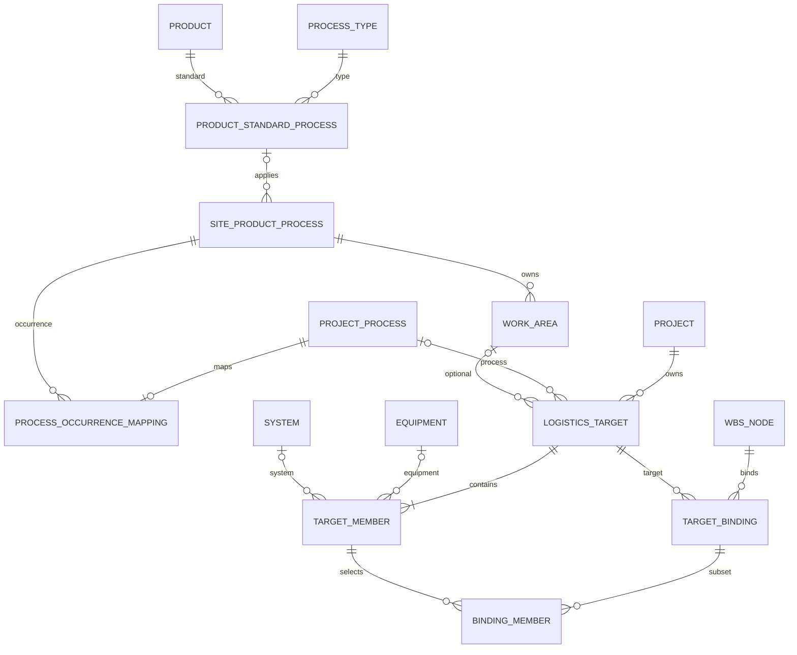

# Logistics Target 계약 — F0 (#614)

상위 [Epic #613](https://github.com/planner77/masterGantt/issues/613). 기준은 2026-10-11 main `cbc73740236f3b3e177e2ed3196a0d02a292c741`, application `0.104.4`, `@svar-ui/react-gantt 2.7.3`다. 이 문서는 **후속 구현의 확정 설계 계약**이며 F0에서 runtime/SQL/API/UI를 추가하지 않는다. 실행 순서·담당·Gate는 [Target/Resource 실행 계획](exec-plans/active/TARGET_RESOURCE_ROLLOUT.md), 이번 증거는 [#614 Work Packet](exec-plans/active/ISSUE_614.md)에서 관리한다.

## 1. 결정·우선순위·비범위

| 구분 | 계약 |
| --- | --- |
| 사용자 확정 | WBS와 물류 구조 분리, 관리용 Summary 허용, 공통 공정 종류, 동일 product ID의 제품 표준 공유, 사업장별 추가 공정, 선택적·공정 occurrence 전용 WorkArea, 인스턴스 재사용, 한 실제 작업의 다중 대상 연결, 동일 원본 편집 |
| 채택 설계 기본안 | 일반 Target의 공정 필수/WorkArea 선택, 공통 MCS 등에는 명시적 `project_common`, whole/subset 두 연결 방식, self/subtree 합집합, 초기 fleet은 비중첩 관리 단위, 첫 Resource 지표는 관련 계획 공수 |
| 비범위 | 실물 개체/BOM·중첩 fleet 계보, 실제 공수·소진공수·원가 배분율, 대수비례/균등배분, 별도 일정 엔진, PRO 도입·복제, 실제 설비 제어, 여러 Project Capacity |

`project_common`은 사용자 확정 용어가 아니라 채택한 설계 기본안이다. 공통 System을 쓰기 위해 가짜 공정/WorkArea를 만들지 않는다. Target membership은 제어(`controls`/`coordinates`)나 Resource 배정을 생성하지 않는다. 관리용 Summary도 기본 `self`이며 의도한 경우에만 `subtree`를 선택한다.

현재 구현 사실은 `src/contracts/logistics.ts`, 실제 Service/Repository 및 migration ledger가 우선한다. 기존 [물류 설계](LOGISTICS_DOMAIN_DESIGN.md)의 과거 계획·고정 enum보다 현재 동적 catalog를 우선하며, **Target 확장에는 이 문서**, 기존 운영 API/DB에는 [API](API.md)/[DB_SCHEMA](DB_SCHEMA.md), Resource 계산에는 [RESOURCE_KPI_DASHBOARD](RESOURCE_KPI_DASHBOARD.md)가 각각 기준이다. 미래 계약을 현재 지원으로 읽지 않는다.

## 2. 현행과 신규 경계

| 현행 원본 | 식별·제약 | F1 이후 추가 |
| --- | --- | --- |
| #538 사업부/제품/사업장·유효 triple | stable public ID, 관계 관리자 | 기존 triple 검증 재사용; 사업부별 product 복제품 금지 |
| `project_processes` | integer PK + UUID `public_id`, `UNIQUE(project_id,code)`, 자유 parent tree | 공통 occurrence와 명시 매핑; 이름으로 추론 금지 |
| `project_equipment` | 같은 Project process 필수, unit=1/fleet≥1 | 원본 그대로 member typed FK로 재사용 |
| `project_logistics_systems` | Project-local UUID, controller/coordinator, project/processes scope | 같은 System instance의 여러 Target 재사용 |
| 물류 type catalog | immutable code string, 독립 catalog revision | Equipment/System master 중복 생성 금지; Process Type은 별도 의미 |
| Task 직접 Equipment/System link | self/subtree, composite project FK | 보존; Target binding과 별도 provenance |
| `task_assignments`·Resource/Group/Role | 공수 grain Project+Assignment | 기존 계산기에 Target 분석 축만 확장 |

위 테이블의 실제 DB 이름은 [DB_SCHEMA](DB_SCHEMA.md)와 migration으로 확인한다. 현재 DTO 종류는 string이며 AMR/ACS/MCS를 새 enum으로 고정하지 않는다. 기존 System project scope와 신규 Target `project_common`은 서로 다른 개념이다.

## 3. ER·identity·cardinality

아래 이름은 **신규 논리 스키마 계약**이다. F1/F2에서 SQL·DTO·migration 이름과 실제 제약을 동기화한다. 신규 master/entity ID는 UUID public ID + 내부 integer PK를 사용하며 label/code를 FK로 사용하지 않는다. 각 Project-local table은 `UNIQUE(project_id,id)` 및 composite FK를 제공한다.



| 신규 논리표 | 필수 FK / unique·검증 |
| --- | --- |
| `process_types` | UUID identity, immutable code unique, name/active/sortOrder. 설비 유형 catalog와 혼동하지 않음 |
| `product_standard_processes` | productId + processTypeId, `UNIQUE(productId,code)`. 같은 type의 별도 표준 공정은 서로 다른 occurrence code/ID로 구분 |
| `site_product_processes` | siteId/productId + processTypeId, optional standardProcessId, `UNIQUE(siteId,productId,code)`. standard가 있으면 product/type 일치. 추가 공정은 standard=null. #538 유효 triple 검증 |
| `work_areas` | occurrenceId 필수, `UNIQUE(occurrenceId,code)`. 다른 occurrence로 이동하지 않고 새 ID로 명시 재배치 |
| `project_process_occurrence_mappings` | `UNIQUE(projectId,projectProcessId)`, occurrenceId 필수. 여러 자유 공정을 같은 occurrence에 명시 매핑 가능. Project product/site/triple과 일치 |
| `logistics_targets` | projectId, `UNIQUE(projectId,code)`, scope=`process\|project_common`. process이면 projectProcessId와 occurrence mapping 필수, workAreaId는 선택이며 매핑 occurrence와 일치. project_common이면 둘 다 null |
| `logistics_target_members` | project/target FK, kind=`equipment\|system`, equipmentId/systemId 정확히 하나. `UNIQUE(projectId,targetId,equipmentId)` 및 System 동등 제약. 빈 Target 저장 불가, member UUID는 재추가 시 신규 |
| `task_target_bindings` | project/task/target FK, `UNIQUE(projectId,taskId,targetId)`, scope=`self\|subtree`, selection=`whole\|subset`. subtree는 Summary만 |
| `task_target_binding_members` | project/binding/target/member 복합FK로 같은 Target에 구속, unique(bindingId,memberId), coverage 선택. subset은1건 이상, whole은0건 |

SQLite 복합FK의 부모 key도 명시한다. bindings에는 `UNIQUE(projectId,id,targetId)`, members에는 `UNIQUE(projectId,targetId,id)`를 두고 subset의 `(projectId,bindingId,targetId)`와 `(projectId,targetId,memberId)`를 각각 참조한다. 따라서 다른 Target의 member가 같은 Project에 있다는 이유로 통과하지 않는다. WorkArea에는 `UNIQUE(occurrenceId,id)`, 매핑에는 `UNIQUE(projectId,projectProcessId,occurrenceId)`를 둔다. Target은 검증용 occurrenceId도 저장해 `(projectId,projectProcessId,occurrenceId)`를 매핑에, `(occurrenceId,workAreaId)`를 WorkArea에 참조한다. process scope는 process/occurrence 모두 필수, project_common은 process/occurrence/WorkArea 모두 null이다. 제품 표준의 `(id,productId,processTypeId)` unique를 occurrence의 동일 세 참조 FK로 결속한다.

행 개수와 Task 유형 같은 다중 행 제약(빈 Target·빈 subset·whole의 subset row0·Summary-only subtree·coverage≤quantity)은 Service의 IMMEDIATE transaction과 usage/타입 변경 경로에서 검증한다. FK만으로 적용됐다고 주장하지 않으며 후속 migration에서는 필요한 trigger/제약·실패 rollback 테스트를 함께 제공한다.

위 표의 사용자 표기는 공정 종류 / 제품 표준 공정 / 사업장 적용·추가 공정 / 작업 구역(WorkArea) / 프로젝트 공정 매핑 / 물류 대상(Target) / 구성원 / 작업 대상 연결 / 선택 구성원이다. SQL 이전의 계약 표이므로 실제 DDL 적용 PASS가 아니다.

Equipment process가 Target process와 다를 때는 일반 Target member 등록을 거부한다. 공유 System은 여러 공정 Target에서 참조 가능하며 기존 scope/controls는 변경하지 않는다. `project_common` Target에는 project scope System만 허용한다(Equipment는 공정 전용이므로 불허). 다른 Project instance/Task/member는 DB와 Service 양쪽에서 거부한다.

### 활성·삭제·revision

공통 기준정보의 초기 제거는 비활성화다. 비활성 참조는 조회·복사에서 보존/경고하고 신규 참조는 거부한다. 사용 중 hard delete는 FK `NO ACTION`과 서비스 usage 검사로 차단한다. Task 삭제는 그 binding/subset을 CASCADE하되 Target/instance는 남긴다. Project 삭제는 Project-local graph만 함께 삭제한다.

Target/member 삭제는 영향 사전 조회 후 binding 정리/명시 재매핑과 한 transaction으로 처리한다. subset member가 삭제되면 subset을 whole로 확대하거나 빈 subset을 유효한 연결로 저장하지 않는다. 사용 중 삭제는 기본 거부하고, 명시적으로 binding 제거 또는 살아 있는 member로 대체해야 한다. 이름/type 변경도 identity를 변경하지 않는다.

기존 Project revision, logistics type catalog revision, resource catalog revision은 별도 원장이다. 신규 공정 catalog aggregate revision은 F1에서 관리자 mutation당1회 증가한다. 표준/occurrence/WorkArea 변경은 공정 catalog revision을 증가시키고 사용 Project의 revision을 임의 일괄 증가시키지 않는다. 대신 report snapshot·영향 token은 Project/catalog/type/resource/calendar의 실제 내용과 revision을 결속한다. Target/member/binding mutation은 Project revision을 transaction당1회 증가시키며 무관한 조회/정렬/그룹화는0회다.

Project mutation은 edit session+정확 Origin+`If-Match`를 서버 transaction 안에서 재검증한다. 신규 공정 참조 변경에는 `processCatalogRevision`을 추가 검증한다. 기존 active type GET에는 revision이 없으므로 이를 이미 제공한다고 가정하지 않는다. type/resource revision을 추가하는 후속 API는 DTO와 소비자를 함께 변경하며, 현재 role setter에 해당 필드가 있다고 기술하지 않는다. Catalog admin 권한은 Project 편집 권한으로 취득하지 않는다.

## 4. 정규화·상속·coverage

binding 입력: `{id, taskId, targetId, scope, selection, memberIds, coverageByMember}`. whole의 memberIds는 비어 있어야 하고 현재 살아 있는 모든 member를 읽는다. subset은 정렬·중복 제거한 명시 member ID이며 Target 소유를 검증한다. 초기 whole coverage는 비지원이며 필요하면 subset을 선택한다. coverage는 연결별 작업 대상 수량으로 Equipment에만 null 또는 양의 정수≤원본 quantity, System은 null만 허용한다. 서로 다른 연결의 coverage를 실물 합계나 공수 배분율로 합산하지 않는다.

Task t의 유효 대상은 직접 binding + 모든 Summary 조상의 subtree binding의 **합집합**이다. 조상 self는 자손으로 전파하지 않고 하위 binding은 조상을 대체하지 않는다. 동일 member는 계산 시 한 번, 출처는 모두 보존한다. 유효 member grain은 `(projectId,taskId,kind,instanceId)`이며 provenance는 `(bindingId,sourceTaskId,targetId,memberId,selection,scope,inherited)`의 정렬된 집합이다. 같은 instance가 TargetA/B에 있으면 Target별 provenance는2개이며 실물 instance는1개다. 상충 coverage를 임의 합산/max하지 않고 각 source 값을 반환해 `coverageState=multiple`로 표시한다.

legacy 직접 연결은 같은 물류 합집합에 별도 `sourceKind=legacy_direct` 출처로 남기고 Target 관련 집계의 자동 member로 변환하지 않는다. 공유 MCS를 통해 Target을 역추론하지 않는다. `targetUnlinked`는 일반 Task의 유효 Target binding이0개인 진단이며 직접 설비 연결 유무와 별도다. Milestone의 가장 가까운 조상 override를 복사하지 않는다. Milestone 자체의 self Target 참조는 책임/문맥만 제공하며 일반 Task 공수를 생성하지 않는다.

구성 변경 사전 조회는 proposed diff와 영향받는 whole/subset binding·Task ID·삭제/coverage 초과·추가된 member를 반환한다. 확인 token은 diff hash + Project/catalog revisions + exact member snapshot에 묶는다. 최종 저장은 동일 token·If-Match·명시 impact confirmation을 다시 검사하며 stale=412, 의미 충돌=409, 입력/foreign selection=400으로 전체 rollback한다. whole에 새 member를 넣으면 기존 whole Task 범위가 넓어짐을 표시한다. 조회만으로 저장하거나 확인을 자동 체크하지 않는다.

## 5. 필터 계약과 반례

신규 축은 targetIds/processOccurrenceIds/workAreaIds/memberEquipmentIds/memberSystemIds다. 배열 내부 OR, 축 사이 AND. **하나의 유효 binding→Target→member 경로에서 모든 Target/member 조건을 만족**해야 한다. Task 전체에서 target A 조건과 target B의 member 조건을 각각 찾아 연결하지 않는다. process/WorkArea는 Target 문맥이고 Equipment 소속 공정의 이름 검색과 혼합하지 않는다.

Equipment와 System 축을 동시에 지정하면 같은 binding의 선택 구성원 안에 각 조건을 만족하는 Equipment와 System이 각각 있어야 한다. 서로 다른 kind가 하나의 member일 수는 없으므로 이 경우 공통 연결점은 binding이다. 같은 kind의 ID/type 등 조건은 동일 member에서 만족해야 한다. F0 fixture의 `memberEntityIds`는 한 kind 조건의 간소화 별칭이며 공개 HTTP DTO가 아니다.

| 예 | 결과 |
| --- | --- |
| t가 A ACS-only, B whole에 연결; target=A AND member=AMR-B | 불일치. 서로 다른 binding을 조인하지 않음 |
| t가 A ACS-only; target=A AND member=AMR-A | 불일치. Target의 전체 구성보다 실제 선택 member 우선 |
| target=A AND system=MCS1 | A에서 MCS1이 선택된 binding에만 일치; B 공유 여부는 무관 |
| directEquipmentIds=AMR-A | legacy 직접/기존 subtree 직접설비 경로만; Target 선택을 자동 추론하지 않음 |
| directEquipmentIds=AMR-A AND target=A | 독립인 두 명시 출처 조건을 같은 Task에서 AND; 단 Target/member 축 내부는 같은 경로 |

생략/빈 배열은 제한 없음이다. `workAreaIds=[null]`은 명시 무구역(공정 Target의 WorkArea 없음과 project_common 포함), `targetIds=[null]`은 유효 Target 미연결 진단이며 member 조건과 함께 선택하면400이다. HTTP는 null을 `unassigned`로 명시 인코딩한다. 중복 token은 unique/sort하되 raw 수량도 한도 계산, empty token/unknown key/반복 scalar/잘못된 UUID=400 INVALID_REQUEST, 존재하지 않거나 타 Project 선택=400 INVALID_SELECTION. 조회 성공0건은 정상 empty와 구분하고 catalog/network 오류를 빈 결과로 치환하지 않는다. 기존 직접설비 API의 parser를 이 신규 계약으로 조용히 바꾸지 않는다.

## 6. Resource KPI 확장 사전

기존 T0/A/R 구분·개인조건 same-assignment·Calendar·null/M/M·full Milestone Gate를 유지한다. Target 조건은 T0 작업과 A의 해당 작업 기여를 좁힌다. R은 Project 전체 개인 참조와 개인 분류로 정하며 선택 Target/Task/Assignment로 Capacity 모집단을 축소하지 않는다. Group 직접 참조는 개인 Assignment가 아니다.

| 지표 | grain / 분모 | null·중첩 / exact drill |
| --- | --- | --- |
| 대상 Task/완료·진척 | distinct taskId, 완료율 분모=A의 Task, 진척=canonical duration 가중 |0건 비율null, Target 간 중첩; Task IDs + canonical 일정 |
| 관련 계획 M/D | distinct(projectPublicId,assignmentId), Resource 유효근무일×allocation/100 | Target 소계 중첩; 전체 원시 합집합 재계산; Assignment IDs+출처 |
| 관련 계획 M/M | 같은 raw M/D / 유효 양수 mdPerMm | 기준없음null, 숨은20/21일 없음; 같은 상세 scope |
| 고유 Equipment 수량 | distinct Equipment instance의 quantity 합 | fleet 중첩ID 자동 dedup 불가, coverage와 별도; instance/member IDs |
| 고유 System 수량 | distinct System instance 개수, 1instance=1식 | 공유MCS1회, Target 소계 중첩; instance/member IDs |
| Target 미연결/개인 미배정/Group only | T0 고유 일반 Task, 기존 진단 분모 유지 | 개인조건 비적용 명시; assignment=null 상세 |
| 공수 미설정 | null allocation Task/Assignment 각각, T0 진단 | knownMd와 unset IDs 병기; all-unset plannedMd=null |
| Capacity/전체 과투입 | 고유 Resource-day / 실제 capacity | selected80%와 Project140% 병기, 대상 선택 밖 demand 보존 |

empty는0/partial=false, all-unset은known0/plannednull/partial=true, partial은known 합/planned 같은 합/partial=true, 설정0은 Resource 근무일0의 configured0이다. allocation0 저장을 허용하는 뜻이 아니다. Resource 복수 Group/Role 소계도 겹치며 소계 합을 전체로 사용하지 않는다. rounding은 표시 경계만, 완료/진척은 계획 공수를 차감하지 않는다.

report provenance에는 schemaVersion/project revision/process catalog revision/logistics type revision/resource catalog revision/calendar fingerprint/정규화 filter/기간/환산기준/snapshotId 및 target-binding-member source를 포함한다. 상세/Excel은 같은 snapshot+selector를 사용한다. 삭제·재매핑·revision이 바뀌면409 REPORT_STALE로 재조회한다. 원시 상한과 projection cell/응답 byte 상한을 먼저 검증하고422로 거부하며 절삭 결과를 전체 합계로 표시하지 않는다. 신규 축의 구체적 예산은 #620에서 기존 `RESOURCE_DASHBOARD_LIMITS`와 함께 테스트하고 공개한다.

## 7. 후속 API·UI 계약

아래는 **신규 API 제안 경로**이며 현재 endpoint가 아니다. F1~R2 구현 때 [API](API.md)에 실제 요청/응답/오류/한도를 갱신한다.

| 담당 | 제안 operation | 권한·atomic 경계 |
| --- | --- | --- |
| #615 | `/api/process-catalog` 관리자 CRUD / Project용 active lookup | master admin session/Origin/catalog If-Match; 읽기는 기존 read guard, inactive 사용 출처 보존 |
| #616 | Project `/logistics/targets`, `/{targetId}/impact` | existing Project session/Origin/revision; instance 재사용·생성+member 저장은 한 transaction |
| #617 | Task `/logistics/targets` binding 전체 교체 | subset 소유·Summary scope·coverage 검사 후 canonical aggregate 반환 |
| #619/#620 | 기존 resource-dashboard/plan/detail의 versioned Target 축 | same read guard/private no-store; 기존 parser/클라이언트 호환과 snapshot 확장 함께 검증 |

모든 신규 mutation은 Route Handler → Service → Repository → SQLite를 따른다. 권한·Origin·revision·usage와 입력 검사를 dry-run에도 적용하고 secret/session을 URL·fixture·로그에 넣지 않는다. 저장 응답은 전체 canonical 계약을 보존해 다른 탭/기존 mutation에서 신규 필드가 사라지지 않게 한다.

### Text wireframe

```text
Project Workspace > 물류 대상
[대상 검색] [추가]                    기존 파란색 Light / system font
대상 목록 | 대상 이름·코드 / 공정 대상 또는 프로젝트 공통
          | 사업장·제품(현재 Project) > 공정 occurrence > WorkArea(선택)
          | 구성원: [기존 인스턴스 검색·재사용] [새 설비/시스템]
          | 종류 / 라벨 / 원본 수량 / 선택 상태
          | 영향: whole 연결 범위 변경·삭제 충돌·영향 Task
          | [취소] [저장]  master 관리 링크는 관리자에게만

공통 Task Editor > 물류 대상 연결
대상 | 적용: [이 항목 self / 하위 포함 subtree(Summary만)]
     | 구성: [대상 전체 whole / 선택 구성원 subset]
     | subset 구성원 체크·선택적 작업 대상 수량
직접 연결 / 조상 상속 출처(읽기 전용) / 기존 직접 설비·시스템(별도)
[취소] [저장] — 상속 해제 버튼으로 조상 범위를 덮어쓰지 않음

Resources > Group / Resource / Target (동일 보고 snapshot)
필터·기간·분모·관련 계획 공수 안내
가상 그룹(읽기 전용) > 원시 Task/Assignment [원본 편집] [일정에서 보기]
편집 종료 → 원래 필터·선택·스크롤 / 결과 갱신 또는 stale 표시
```

### State matrix

| 상태 | 표시·행동·focus |
| --- | --- |
| readonly | 필터/출처/상세 조회 허용, 저장·생성 handler도 잠금; admin 권한을 Project unlock으로 대체하지 않음 |
| loading/lookup error | 로딩 발표·재시도, 오류는 empty와 구분; 기존 draft 보존, 불완전 선택 저장 차단 |
| empty/no results | 데이터없음/조건일치없음 구분, 필터 해제 제공; 자동 객체 생성 없음 |
| dirty | 같은 Task/Target draft 유지; 전환·닫기·Escape는 기존 unsaved 확인, 저장 없는 전환을 성공으로 알리지 않음 |
| impact confirmation | 추가/삭제 영향과 전체/선택 범위 명시; 명시 확인 전 mutation0, stale token 재사용 금지 |
| pending | 이중저장·반복 닫기 잠금, focus modal 내부 유지, 응답 전 UI 권한을 믿지 않음 |
| validation error | inline error+필드 연결된 focusable 오류 요약, draft 보존·첫 오류 이동; 서버 설명 노출은 기존 안전 문구 |
| network/응답 유실 | draft 보존, 생성 POST 자동 재전송 금지; canonical 재조회로 실제 저장 결과 확인 |
| session 만료/401/403 | mutation 잠금·재인증/권한 안내, draft 자동 폐기 금지; password/token은 URL·오류에 노출하지 않음 |
| stale412/report409 | 최신 조회·재검토 제공, draft 무음 덮어쓰기 금지, stale 합계로 편집/Excel 실행 금지 |
| success | canonical ID/revision으로 모든 보기 반영 또는 명시 stale; 원래 trigger에 preventScroll focus 복원 |
| inactive/deleted selection | 기존 inactive 라벨 보존, 신규 선택 거부; 삭제된 subset은 오류/명시 재매핑으로 해결 |

가상 row key와 canonical Task/Assignment/Target ID를 분리한다. grouping row 날짜·진척·공수는 읽기 전용 projection이며 Summary로 저장하지 않는다. 편집은 기존 공통 editor/gateway를 사용하고 조회 정렬/그룹 변경은 WBS parent·일정·revision을 변경하지 않는다. Gantt remount/private store/new viewport writer를 추가하지 않는다. keyboard(Tab/Shift+Tab/Arrow/Home/End/Escape), focus 복원, 390/768/1024/1440/wide·긴 label 검증은 #618/#621에서 실제 조작으로 수행한다. F0 wireframe은 브라우저 PASS가 아니다.

## 8. 이관·복사·Template·JSON·rollback

| 경로 | 현행 사실 | 후속 계약·안전 Gate |
| --- | --- | --- |
| migration | ledger 최신0024, 적용SQL checksum 불변·순차 migration, pending batch transaction/FK check | F1부터 additive tables/nullable 명시 mapping; 기존 자유 공정·이름을 자동변환하지 않음. 적용 전 backup, 중간 실패 전부 rollback |
| 기존 Project | 기존 logistics/직접 link 운영 | Target0개로 유효; unmapped 목록+명시 매핑 preview, 영향/revision 확인 후 저장 |
| process 재매핑 | 현재 공통 occurrence 없음 | 사용 Target/WorkArea를 함께 재검증, 불일치 남으면 전체거부. label 동명 매핑 금지 |
| Project copy | local IDs remap, global Resource IDs 유지, canonical revision 신규1 | Target/member/binding/subset/coverage 전부 local ID remap, 동일 copy transaction. cross-triple copy는 명시 재매핑 또는 거부, 일부 누락 성공 금지 |
| Template | logistics code 참조+Resource publicID+Task externalID snapshot, 새 local ID 생성, schemaVersion 없음/옛 omission 허용 | versioned Target extension/capability 검사 선행. code는 포맷 내부 참조만, 런타임 identity 아님. 누락 member/occurrence는 오류; 현재 resolver의 일부 누락 필터를 새 Target에 재사용 금지 |
| WBS JSON1.0/1.1·CSV | strict 입력, logistics/Resource 전체 backup 아님 | 기존 포맷에 몰래 Target 삽입/무시 금지. 지원 전 Target 포함 export/import/copy는 명시 경고·거부/선택 동의, 무손실 왕복 주장 금지 |
| #379 전체 참조 JSON | 별도 외부 참조 snapshot 범위 | occurrence/WorkArea/Target/member/binding/provenance의 versioned schema 인계; 복원 가능한 backup과 구분 |
| Resource/Excel | 기존 원시 Assignment/Calendar/same snapshot 상세 | 새 축/필터/selector/fingerprint를 일치 확장, raw detail/exact 합계 교차검증; 보고를 import 포맷으로 표시하지 않음 |
| Task type/move/delete | 기존 canonical 변경 경로 | subtree를 비Summary로 바꾸면 명시 정리/거부, move는 새 조상 합집합 재계산; Target/instance 복제0 |
| rollback | 자동 down migration 미지원, 이전 app은 새 ledger 해석 불가 | schema-only라며 구 app만 되돌리지 않음. 일관된 업그레이드 전 DB backup+대응 app 복원 또는 forward corrective migration; 새 데이터 유실 경고·복구 실증 |

F0은 migration을 실행하지 않으므로 운영 DB 적용/backup-restore는 NOT TESTED다. F1/F2는 빈 DB·기존0024 DB·실패 rollback·재시작·cross-project FK·inactive·copy/template를 각 PR에서 검증한다. 기능 노출은 저장·canonical·호환 guard가 준비된 단계에만 한다.

## 9. 공통 fixture와 수용 경계

`tests/fixtures/logistics-targets.ts`와 `tests/domain/logistics-targets-contract.test.ts`는 운영 자료가 아닌 **F0 계약 oracle**이다. 후속 Domain/API/UI/Excel adapter는 같은 case ID·입력·기대 원시ID/출처/수치를 소비한다. test-only 정규화 성공은 신규 runtime/DB/API 구현 성공이 아니다. 실행 명령·결과는 [Work Packet](exec-plans/active/ISSUE_614.md)에 기록하며 문서 기대값만으로 PASS를 부여하지 않는다.

기본 fixture: 제품P 조립/검사 표준, siteA 조립 WorkArea A/B, siteB 동일 표준+특수검사, 검사 WorkArea 없음. TargetA=AMR A10+ACS A+MCS1, TargetB=AMR B5+ACS B+동일 MCS1. 고유 Equipment15대/System3식(ACS2/MCS1). ACS-only Task는 AMR0대. 통합 Task의5유효근무일·한 개인100% Assignment는 A5/B5/전체5 M/D. 공동담당자50%를 추가하면 raw5+2.5=7.5이며 같은 개인의 복수 Group 소계가 이를 전체에서 복제하지 않는다.

공통 cases는 공정/WorkArea 오귀속, whole/subset·self/subtree·직접+조상 중복, subset 삭제·명시 재매핑, legacy 무추론, coverage, 미연결/개인미배정/Group only, empty/all-unset/partial/configured0, M/M 기준없음, selected80%/Project140%와 same-binding 반례를 포함한다. 실제 저장 API/Excel·브라우저·운영 복구의 통합 기대값은 후속 #615~#623의 NOT TESTED 항목이다.

| 공통 case ID | 검산 범위 |
| --- | --- |
| F0-L01~L20 | whole/subset·self/subtree·합집합 출처·legacy 직접/조상 혼합·삭제·명시 재매핑·오귀속·whole 입력 오류·순열/중복 |
| F0-P01~P08 | occurrence/WorkArea 귀속·project_common·두 사업장 표준 공유/추가 |
| F0-Q01~Q02 | Equipment15/System3 및 physical10과 coverage C1=2/C2=3 개별 출처·multiple 상태 |
| F0-F01~F12 | 선택된 binding/member 경로의 조건 일치; A ACS-only가 A AMR/MCS로 확대되지 않음·Equipment/System 동시 조건 |
| F0-R01~R11 | 관련 raw M/D·공동담당/Group·미배정/null/partial/설정0·A5 B5 전체5·80/140·T0·M/M 기준없음 |

F0-Q02의 서로 다른 연결 coverage2/3은 합산 수량5나 실물 수량15로 표시하지 않는다. F0-L/P는 읽기 쉬운 별칭 ID로 신규 계약을 검산하며 Project 격리/FK/If-Match·삭제/영향 token의 실제 SQLite/HTTP 구현은 F1~F3에서 검증한다.

## 10. SVAR 기능·설치 버전 검토

조회일 2026-10-11. 최신 공식 웹 문서와 설치 package는 별도 근거다. URL 조회와 type 선언 확인만 수행했으며 demo 직접 조작은 NOT TESTED다.

| 기능 | 공식 문서·지원 구분 | 설치2.7.3 확인·채택 |
| --- | --- | --- |
| Tasks identity/parent/custom fields | [tasks](https://docs.svar.dev/react/gantt/api/properties/tasks/) Core 기본 필드 | react-gantt `types/index.d.ts`가 gantt-store re-export; 기존 canonical adapter 사용, 날짜 exclusive→app inclusive 경계 보존 |
| public action | [api.exec](https://docs.svar.dev/react/gantt/api/methods/exec/) | gantt-store2.7.2 `dist/types/DataStore.d.ts`/IApi; 기존 gateway에서만 호출, 서버 권한 대체 아님 |
| Filtering | [Filtering guide](https://docs.svar.dev/react/gantt/guides/data-operations/filtering/), [filter-tasks](https://docs.svar.dev/react/gantt/api/actions/filter-tasks/) 조회 성공 | DataStore.d.ts의 filter-tasks 선언 확인. 잘못된 filtering-tasks 경로 오류와 구분; 새 Target 필터 UI 실증은 후속 |
| Grouping | [Grouping](https://docs.svar.dev/react/gantt/guides/data-operations/grouping-tasks/) PRO | 공용 types의 groupBy 선언은 Core 사용 권한/동작 증거 아님; app-owned projection 표·기존 editor 채택 |
| ResourceLoad | [Resource load](https://docs.svar.dev/react/gantt/guides/resources/resource-load/) PRO | 공용 선언 노출만으로 Core 채택하지 않음; 기존 Resource Calendar/KPI/Plan 엔진 재사용 |
| Task rollup bar | [tasks](https://docs.svar.dev/react/gantt/api/properties/tasks/) PRO | rollup type 선언은 기능 지원 증거 아님. 관련 계획 공수 집계와 별개; 도입하지 않음 |
| Editor | [Editor](https://docs.svar.dev/react/gantt/guides/ui-layout/editor/) 구성 참고 | 기존 custom Task Editor·dirty/revision/focus/gateway 유지; 신규 필드 실동작 후속 |
| Base demo | [Willow sample](https://docs.svar.dev/react/gantt/samples/#/base/willow) 진입점 조회 | JS sample 직접 조작/반응형/keyboard 실증 NOT TESTED |

최신 예제의 `@svar/react-gantt` import를 설치된 `@svar-ui/react-gantt`에 그대로 복사하지 않는다. 설치 types에 PRO 이름이 존재하는 것은 라이선스나 실제 Core 동작 검증이 아니다. Resource KPI 집계는 독립 원시 집합 계산이며 PRO 내부 구현을 복제하지 않는다.
